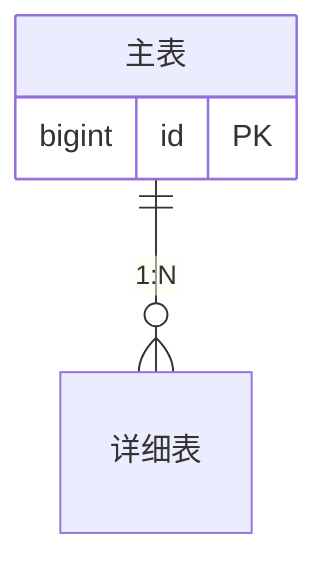
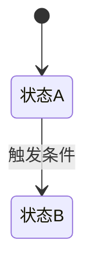

# <域名> 业务逻辑总览（business-design）

> 复制到 `docs/<domain>/business-design.md` 后填充。

## 1. 背景与边界

### 已知信息 → 本设计落点

| 已知信息 | 本设计的落点 |
|---|---|
| <需求/约束 1> | <对应章节/决策> |

### Non-goals（明确不做，对齐 CLAUDE.md 项目边界）

- <不做事项>（例外裁决：<如有，写清裁决与原因>）

## 2. 领域模型总览

**拆分原因（必写）**：<如"主表/详细表拆分，原因：列表不碰正文大字段，读多写少视角">

## 3. 状态机与业务规则

### 状态码表

| 状态码 | 语义 | 允许的迁移 |
|---|---|---|
| <待填> | <待填> | <待填> |

### 业务规则（逐条编号，供任务引用）

- R1：<规则描述>
- R2：<规则描述>

### 编号规则

<id/单号/slug 的生成与格式规则>

## 4. 库表设计（摘要，详细以 table-design 为准）

| 表 | 用途 | 详细契约 |
|---|---|---|
| <表名> | <用途> | 见 table-design.md §<x> |

冲突以 table-design.md 为准。

## 5. 接口契约（摘要，详细以 api-design 为准）

| # | 接口 | 用途 | 详细契约 |
|---|---|---|---|
| 1 | <方法 路径> | <用途> | 见 api-design.md §<x> |

关键 DTO 字段：<仅列跨文档有歧义的字段>

## 6. 前端边界

### 端职责表

| 端 | 职责 | 不负责 |
|---|---|---|
| 管理端 | <待填> | <待填> |
| 用户端 | <待填> | <待填> |

### 信息架构（路由树）

<路由树，待填>

> **定稿后动作**：本节定稿后据此生成 `prototype.html`（有前端边界的域必做）：每个页面元素标注契约锚点（对应 api-design 接口 # 编号 / 业务规则 R 编号）。纯后端域省略时，在 README 登记省略原因。

## 7. 横切与安全（只接线、不改口径）

| 能力 | 本域怎么接 | 口径来源 |
|---|---|---|
| <如幂等> | <待填> | CLAUDE.md §<x> |

## 8. 架构落点（实施硬约束）

<哪个模块放什么，模块归属图/表>

## 9. 部署与迁移

- SQL 位置：<待填>
- 种子数据：<待填>
- 回滚方案：<待填>

## 10. 文档分工

| 本文放什么 | 不放什么 |
|---|---|
| 业务规则、状态机、领域模型、边界 | 实现代码、完整枚举表、字段级契约（查 table/api-design） |
| 端职责、架构落点 | 生产密钥、端口账密、依赖版本（查登记处） |
