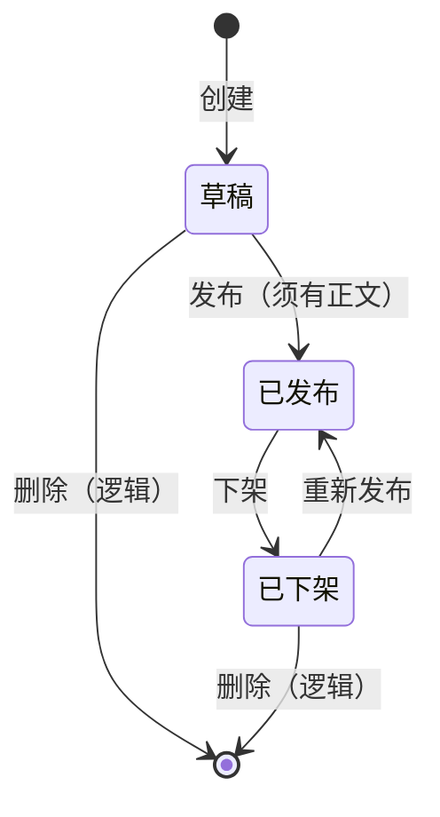

# 博客内容业务 · 设计文档

> 状态：**设计稿**（业务逻辑与库表契约；**不含**实现代码与 openspec 提案）
> 定位：blog 系统内容业务域的**业务逻辑与数据模型**设计——分类、标签、文章主表、文章详细表、正文 OSS、管理端与用户端边界
> 范围：领域模型、库表、状态机、接口契约、权限、对象存储正文策略、两端前端职责
> 配套：`CLAUDE.md`（契约口径唯一源：返回体/错误码/审计字段/发号/幂等限流）、`object-storage-design.md`（**对象存储唯一裁剪源**）、`rbac-design.md`（权限标识）、`admin-ui-design.md`（管理端视觉）、`docs/error-code-ranges.md`、`docs/test-env.md`
> 关联现状：`scaffold-blog-system` 已交付 RBAC / 文件 / 审计 / 发号 / 幂等等横切；本设计只补内容业务域，不改横切口径

---

## 1. 背景与边界

### 1.1 背景

blog 系统骨架已落地（`backend/blog/*`、`frontend/blog-admin`、`blog_db` 基础表）。内容业务需支撑：

- 管理端：维护分类、标签、文章（含正文）
- 用户端：阅读已发布文章（分类/标签浏览、详情阅读）

已知信息（本设计展开为完整契约）：

| 已知 | 本设计落点 |
|------|-----------|
| 文章分类 | `blog_category` + 管理/用户端筛选 |
| 文章标签 | `blog_tag` + `blog_article_tag` 多对多 |
| 文章主表 | `blog_article`（列表/摘要/状态/归属） |
| 文章详细表 | `blog_article_detail`（正文元数据与可检索摘要字段） |
| 具体信息存 OSS | 正文 **Markdown** 对象写 MinIO；业务只持 `content_file_id` / `draft_file_id`，定位经 `sys_file.object_key` |
| 已有管理前端、需建用户前端 | `blog-admin` 扩内容管理页；**新建** `blog-portal` |

### 1.2 项目边界（Non-goals）

对齐 `CLAUDE.md` §1 / §2.2，本业务域**明确不做**：

- 评论、点赞、收藏、阅读量统计、访客分析（需要时另开变更）
- 用户注册/登录/个人中心/作者主页（归用户中心、认证中心）
- 跨系统 RBAC 同步、跨库分布式事务、Entity 跨服务共享
- Excel、分布式定时任务、多语言强制交付、MinIO 对象定时清理
- 独立搜索引擎（Elasticsearch 等）；检索先 DB，量级不够再开变更
- 生产密钥入仓；连接串/账密只查 `docs/test-env.md` / Nacos
- 改动既有横切能力口径（发号、`@Idempotent`、`@RateLimit`、审计、`sys_file` 既有列与删除语义）
- **例外（已裁决）**：`sys_file` 允许**增量补列** `biz_type`/`biz_id`（见 table-design §2.0）；不改既有列、不改 `deleted` 删除语义

---

## 2. 领域模型总览

```mermaid
flowchart TB
  subgraph taxonomy [分类与标签]
    CAT[blog_category<br/>分类 树]
    TAG[blog_tag<br/>标签]
  end

  subgraph article [文章]
    A[blog_article<br/>主表 摘要/状态/分类]
    D[blog_article_detail<br/>详细表 正文元数据]
    AT[blog_article_tag<br/>文章-标签]
  end

  subgraph oss [对象存储（S3 多服务商）]
    OBJ[正文对象<br/>content/{articleId}.md]
    PROV[sys_storage_provider<br/>服务商配置真相源]
  end

  CAT -->|1:N 分类| A
  TAG -->|M:N| AT
  A -->|1:1| AT
  A -->|1:1| D
  D -->|content_file_id| OBJ
```

**主表 / 详细表拆分原因：**

| 表 | 职责 | 读多写少 |
|----|------|----------|
| `blog_article` | 列表、筛选、排序、状态、分类、摘要、封面 | 高频读（列表/首页） |
| `blog_article_detail` | 正文元数据、字数、目录/SEO 等 | 低频读（仅详情页） |
| OSS 对象 | Markdown **正文全文**（经 `sys_file` 登记） | 详情读；列表**不**加载 |

---

## 3. 状态机与业务规则

### 3.1 文章状态

| 状态码 `status` | 含义 | 用户端可见 | 说明 |
|-----------------|------|-----------|------|
| `0` | 草稿 DRAFT | 否 | 创建默认；可编辑/删除 |
| `1` | 已发布 PUBLISHED | 是 | 需已有正文对象；显示 `publish_time` |
| `2` | 已下架 OFFLINE | 否 | 保留数据；可再发布 |



**规则：**

1. 删除仅对 `草稿` / `已下架` 开放（逻辑删除 `deleted=1`）；已发布须先下架
2. 发布前必须存在正文（OSS 对象可读 + `blog_article_detail` 有 `content_file_id` 或 `draft_file_id`）
3. 发布 / 下架 / 重发 为关键写：`@Idempotent` + 审计
4. 用户端**只**读 `status=1 AND deleted=0`
5. 改分类/标签不影响状态；改正文不自动改状态（已发布文章改正文即时生效，见 3.3）

### 3.2 分类 / 标签

| 项 | 分类 `blog_category` | 标签 `blog_tag` |
|----|----------------------|-----------------|
| 结构 | 树（`parent_id`，最多 2 级） | 扁平 |
| 唯一 | 同级 `name` 唯一 | 全局 `name` 唯一 |
| 停用 | `status=0` 用户端不展示；**已有文章仍挂原分类** | 同左 |
| 删除 | 无子分类且无文章才可逻辑删 | 无关联才可逻辑删 |
| 排序 | `sort` 升序 | `sort` 升序 |

- 分类 `slug`：URL 友好标识，全局唯一；标签同
- 创建/改名/停用/排序为关键写：审计；管理端菜单级权限

### 3.3 正文与 OSS

| 项 | 约定 |
|----|------|
| 正文格式 | **Markdown**（唯一，不设 `content_format`） |
| 存储 | MinIO 对象，**不进** MySQL 大字段 |
| **上传登记** | **每个 OSS 对象必须先写 `sys_file`**（bucket/object_key/原始名/MIME/大小/biz_type/biz_id/操作人），业务只持 `file_id` |
| biz_type | `ARTICLE_LIVE` 线上正文 / `ARTICLE_DRAFT` 草稿 / `ARTICLE_COVER` 封面 / `FILE` 通用 |
| detail 引用 | `content_file_id` / `draft_file_id` → `sys_file.id` |
| objectKey | `blog-content/{articleId}/live/{uuid}.md` 或 `.../draft/{uuid}.md` |
| 详细表 | 只存 file_id 与字数/SEO，**不存正文**；正文固定 Markdown |
| 覆盖更新 | put 新对象 → **INSERT sys_file** → 更新 detail.file_id → 旧 sys_file 行逻辑删 |
| 列表 | **禁止**拉正文对象 |
| 详情 | `content_file_id → sys_file → object_key → MinIO` |
| 大小 | 单篇正文 ≤ **500KB**（`text/markdown`，应用层校验）；封面走 `ARTICLE_COVER` / 通用 `FILE`（既有 MIME 白名单） |

**写入铁律：** 禁止「只 put MinIO、不登记 `sys_file`」；禁止业务表裸存 object_key 而无 file_id 对应行。

**读路径（用户端详情）：**

```
GET /api/v1/public/articles/{idOrSlug}
  → 校验 status=1（id 或 slug 解析）
  → 读 blog_article + detail + tags
  → content_file_id → sys_file（ARTICLE_LIVE）→ object_key
  → ObjectStorageClient 读对象 → 组装 content
  → 返回 ArticleDetailVO
```

**写路径（管理端）——主表 / 详细表 / 正文严格分步：**

#### A. 新建文章（两页：主表页 → 详细表页）

**页面契约（管理端）：**

| 页 | 内容 | 保存 |
|----|------|------|
| **新建主表页** | 标题/slug/分类/标签/摘要/封面/置顶；**无正文框** | `POST /admin/articles` 成功 → **直接跳转写正文页** |
| **写正文页（详细表）** | Markdown 编辑器 + SEO；不改主表字段 | `PUT /admin/articles/{id}/content`（可再发布） |

```
1) 打开「新建主表页」
   → POST /admin/articles
   → 只写 blog_article；status=0；返回 articleId

2) （自动跳转）「写正文页」
   → put 正文到 MinIO + 登记 sys_file
   → 写/更新 blog_article_detail（content_file_id 或 draft_file_id、word_count、seo_*）
   → 主表不在此步更新

3) 「保存正文」或「保存正文并发布」
   → POST /admin/articles/{id}/publish（须 detail 存在 draft_file_id 或 content_file_id）
```

**新建顺序契约：** **主表 INSERT 成功且拿到 id 之后**，才允许写详细表与 OSS；写 OSS 必须 **同步登记 `sys_file`** 再回填 `file_id`。禁止先写 OSS 再补主表作主路径。前端 **禁止** 一页同时提交主表+正文。

#### B. 编辑文章（主表页 / 详细表页分离入口）

| 页面 | 接口 | 只碰 | 不碰 |
|------|------|------|------|
| **编辑主表页** | `PUT /admin/articles/{id}` | `blog_article`（标题/摘要/分类/标签/封面/slug/置顶） | detail、OSS 正文 |
| **写正文 / 改正文页** | `PUT /admin/articles/{id}/content` | MinIO 新对象 + `sys_file` + `blog_article_detail` | 主表业务字段 |
| 发布/下架（列表或正文页） | `POST …/publish` / `…/offline` | 仅主表 `status`/`publish_time` | detail、OSS |

**编辑契约：**

1. **两页两接口**：改信息与改正文不混在同一页同一次提交
2. 保存主表 **不得** 隐式改写 `content_file_id` / `draft_file_id`；保存正文 **不得** 隐式改写标题/分类/标签
3. 已发布文章改元数据或改正文：保持 `status=1`，不自动下架
4. 各关键写分别 `@Idempotent` + 审计（ARTICLE_UPDATE / ARTICLE_CONTENT_UPDATE）

#### C. 草稿 / 发布 双轨正文（已发布文章可改稿且不掉线）

**问题：** 已发布文章若「保存草稿」把线上正文覆盖掉或把 `status` 打回 0，用户端会**看不到原文件**。

**规则：草稿永不挤掉线上正文；只有「发布」才切换线上版。**

| 当前状态 | 操作 | `draft_file_id` | `content_file_id` | `status` | 用户端 |
|----------|------|-----------------|-------------------|----------|--------|
| 从未发布（0） | 保存草稿 | 更新 | 仍空 | 0 | 不可见 |
| 从未发布（0） | 发布 | 清空 | **写入 draft→live** | 1 | 可见（新文） |
| **已发布（1）** | **保存草稿** | **更新** | **不动** | **仍为 1** | **仍看线上旧文** |
| **已发布（1）** | **发布 / 更新发布** | 清空 | **draft 提升为 live** | 1 | 切到新文 |
| 已发布（1） | 仅保存主表信息 | 不动 | 不动 | 1 | 标题等元数据按主表即时生效 |
| 已下架（2） | 保存草稿 | 更新 | 不动 | 2 | 不可见 |
| 已下架（2） | 发布 | 清空 | draft→live | 1 | 重新可见 |

```
保存草稿 PUT /admin/articles/{id}/content
  body: { mode: "draft", content, seo* }
  → put 草稿对象
  → INSERT sys_file（biz_type=ARTICLE_DRAFT, biz_id=article_id, …）
  → 只更新 detail.draft_file_id / draft_* 
  → 不改 content_file_id、不改 status

发布 POST /admin/articles/{id}/publish
  → 无草稿且无线上正文 → 失败「无正文可发布」
  → 有 draft_file_id：
       写/提升为 live 对象并登记 sys_file（biz_type=ARTICLE_LIVE）
       content_file_id ← 新 live 行；draft_file_id=0
  → status=1，publish_time=now
  → 旧 live sys_file 逻辑删，对象运维清理

放弃草稿 DELETE /admin/articles/{id}/draft
  → draft sys_file 逻辑删 + detail.draft_*=0
  → 线上版与 status 不变
```

**编辑器保存按钮（写正文页）：**

| 按钮 | 适用 | 行为 |
|------|------|------|
| 保存草稿 | 任意 | 只写 draft 轨；已发布文**不下线** |
| 发布 / 更新发布 | 有草稿或可发布 | 草稿提升为线上；`status=1` |
| 放弃草稿 | 有未发布草稿 | 丢掉 draft 轨，回到当前线上文 |

**界面提示：** 已发布且存在 `draft_file_id>0` 时，写正文页显示「有未发布草稿 · 线上仍是旧版」；用户端只读 `content_file_id`。

**元数据（主表）简化约定：** 「编辑主表」保存后元数据即时生效（标题/分类/摘要/封面/置顶）；**正文与 SEO 以发布为准**（SEO 存 draft_seo_*，发布时覆盖 seo_*）。若后续需要「元数据也进草稿轨」，再开变更加 draft 列。

#### D. 正文对象覆盖策略

```
写正文（无论草稿/线上）
  → 校验大小（≤500KB，Markdown 正文）
  → put 新对象（draft/ 或 live/ 前缀）
  → UPDATE detail 对应轨指针
  → 旧对象记审计，留给运维清理（不建定时）
```

策略与红线裁剪源 = `object-storage-design.md`（MIME/公开永久 URL/Content-Disposition/删除前引用检查/禁止业务直绑 SDK/禁止网关中转大包 body）。
正文 ≤500KB 经业务 JSON 接口写入后由服务端 put，属「小文件经业务接口」；封面等附件走既有 `/api/v1/files` multipart。

#### E. Markdown 编写约定（写正文页）

> 正文格式**唯一 = Markdown**（不设 `contentFormat`，见 §3.3 / table-design）。本节约定管理端「写正文」如何编写，服务端只收 Markdown 源文。

**1. 编辑器形态**

| 项 | 约定 |
|----|------|
| 组件 | **md-editor-v3**（版本见 `docs/version-baseline.md`），经项目薄封装 `MdEditor.vue` |
| 布局 | **左源码 / 右预览** 分栏（编辑器分屏/编辑+预览；窄屏可切换） |
| 输入 | Markdown **源码**编辑；**不做**产品级所见即所得（WYSIWYG）提交 |
| 工具栏 | 加粗、斜体、标题、链接、行内代码、代码块、图片引用、列表等；**只插入 Markdown 语法**，不写 HTML 标签 |
| 预览 | 编辑器预览仅辅助；对外保存仍是源文。用户端渲染见 §6 portal |
| 禁止 | 粘贴/输入 **HTML 标签作为正文结构**（`<div>`、`<script>`、内联样式等）；粘贴富文本时**降为纯文本 + Markdown**；关闭直传存储 |

**2. 正文内容与语法范围**

| 项 | 约定 |
|----|------|
| 编码 | UTF-8；换行 `\n` |
| 允许语法 | 标题 `#`–`######`、段落、有序/无序列表、引用、围栏代码块、行内代码、链接、图片、粗体/斜体、分隔线、表格（可选） |
| 图片 | 仅允许 **http(s) 相对站内/白名单外链**；**推荐**编辑器「上传」→ `POST /api/v1/files`（`bizType=ARTICLE_IMAGE`）后插入稳定地址 `/api/v1/public/files/{id}`；禁止 base64 内嵌大图（防超 500KB） |
| 链接 | 默认 `http/https`；禁止 `javascript:` 等可执行协议 |
| HTML | **一律视为文本**（源文可含转义，渲染时不得当 HTML 执行）；用户端渲染必须转义后再生成（与 portal `renderMarkdown` 一致） |
| 长度 | 单篇源文 **≤500KB**（UTF-8 字节数）；超限拒绝（`CONTENT_TOO_LARGE`），不截断 |

**3. 字数与元信息**

| 项 | 约定 |
|----|------|
| `word_count` | **展示用**字数：去 Markdown 标记后的可见字符/词估算（实现可简单按去语法后长度）；**仅**用于管理端展示与 SEO 参考，不参与发布门禁 |
| 计算时机 | 保存草稿/发布时后端计算并落 `word_count` / `draft_word_count` |
| 与 SEO | 正文写入不影响 `seo_*`；SEO 仍走 `draft_seo_*` → 发布覆盖（§C） |

**4. 保存与失败**

| 项 | 约定 |
|----|------|
| 入参 | `content` = **Markdown 源文**（JSON 字符串）；无格式字段 |
| 服务端 | 校验非空 + ≤500KB → put `…/{uuid}.md`（MIME `text/markdown`）→ `INSERT sys_file` → 回填轨 |
| 前端 | 保存前可提示字数/大小；**禁止**把 HTML 渲染结果当 content 提交 |
| 失败 | 超限/空内容返回业务/校验码；对象存储失败记 error 含 providerCode/objectKey（对象存储补偿见 `object-storage-design.md`） |

**5. 与用户端渲染边界**

- 管理端预览、用户端详情共用「Markdown → HTML」策略：**先转义再渲染**，不执行原生 HTML。
- 用户端不提供「按 HTML 原文展示」；`content` 字段始终是 Markdown 源文。

---

## 4. 库表设计

> **字段级契约以 [table-design.md](./table-design.md) 为唯一源**（含新增/修改清单、索引、种子）。
> 本节只保留领域摘要；**冲突以 table-design 为准**。关系图见 [er-diagram.html](./er-diagram.html)。
> 约定：表名 `snake_case`；审计字段齐套（`CLAUDE.md` §6.4.5）；主键 **16 位发号**（`yyyyMMdd` + 8 位日序列）；`id` 对外 String；无物理外键；`uk_` 不做写幂等。

**新增 6 表：** `blog_category` / `blog_tag` / `blog_article` / `blog_article_detail` / `blog_article_tag` / `blog_site_config`。
**既有表：** `sys_file` **增量补列** `biz_type`/`biz_id`（唯一修改，见 table-design §2.0）；封面 `cover_file_id`、正文 `content_file_id`/`draft_file_id` 均 → `sys_file.id`；**禁止**业务表裸存 `object_key`。

### 4.1 `blog_category` 文章分类

| 字段 | 类型 | 空 | 默认 | 说明 |
|------|------|----|------|------|
| id | BIGINT | N | 发号 | 主键 |
| parent_id | BIGINT | N | 0 | 父分类，0=根；最多 2 级 |
| name | VARCHAR(64) | N | | 分类名 |
| slug | VARCHAR(64) | N | | URL 标识 |
| description | VARCHAR(255) | N | '' | 描述 |
| sort | INT | N | 0 | 排序 |
| status | TINYINT | N | 1 | 1 启用 / 0 停用 |
| create_time / update_time / create_by / update_by / deleted | — | | | 审计（6.4.5） |

- 索引：`uk_blog_category_slug(slug)`、`idx_blog_category_parent_id(parent_id)`、`idx_blog_category_status(status)`

### 4.2 `blog_tag` 文章标签

| 字段 | 类型 | 空 | 默认 | 说明 |
|------|------|----|------|------|
| id | BIGINT | N | 发号 | 主键 |
| name | VARCHAR(64) | N | | 标签名 |
| slug | VARCHAR(64) | N | | URL 标识 |
| sort | INT | N | 0 | 排序 |
| status | TINYINT | N | 1 | 1 启用 / 0 停用 |
| 审计字段 | | | | 同上 |

- 索引：`uk_blog_tag_name(name)`、`uk_blog_tag_slug(slug)`、`idx_blog_tag_status(status)`

### 4.3 `blog_article` 文章主表

| 字段 | 类型 | 空 | 默认 | 说明 |
|------|------|----|------|------|
| id | BIGINT | N | 发号 | 主键 |
| slug | VARCHAR(120) | N | '' | 友好 URL；空则用 id |
| category_id | BIGINT | N | 0 | 分类 id，0=未分类 |
| title | VARCHAR(200) | N | | 标题 |
| summary | VARCHAR(500) | N | '' | 摘要（列表用，≤500 字） |
| cover_file_id | BIGINT | N | 0 | 封面文件 id（`sys_file`），0=无 |
| author_id | BIGINT | N | 0 | 作者用户 id（快照自网关 `X-User-Id`） |
| author_name | VARCHAR(64) | N | '' | 作者显示名快照（避免列表反查用户中心） |
| status | TINYINT | N | 0 | 0 草稿 / 1 已发布 / 2 已下架 |
| publish_time | DATETIME | NULL | NULL | 首次/最近发布时间 |
| is_top | TINYINT | N | 0 | 1 置顶 |
| view_count | BIGINT | N | 0 | 预留阅读量字段；**本期不写业务逻辑** |
| 审计字段 | | | | 同上 |

- 索引：`uk_blog_article_slug(slug)`、`idx_blog_article_category_id(category_id)`、`idx_blog_article_status_pub(status, publish_time)`、`idx_blog_article_author_id(author_id)`、`idx_blog_article_title(title)`（辅助标题检索）
- 标题检索：管理端/用户端 `title LIKE`（白名单参数绑定，禁止拼 SQL）；中文分词检索不在本期

### 4.4 `blog_article_detail` 文章详细表（正文双轨文件引用）

| 字段 | 类型 | 空 | 默认 | 说明 |
|------|------|----|------|------|
| id | BIGINT | N | 发号 | 主键 |
| article_id | BIGINT | N | | 与主表 1:1，`uk` |
| content_file_id | BIGINT | N | 0 | **线上正文** → `sys_file.id`（biz_type=ARTICLE_LIVE）；0=未发布过 |
| draft_file_id | BIGINT | N | 0 | **草稿正文** → `sys_file.id`（biz_type=ARTICLE_DRAFT）；0=无草稿 |
| word_count | INT | N | 0 | 线上正文字数 |
| draft_word_count | INT | N | 0 | 草稿字数 |
| seo_title | VARCHAR(200) | N | '' | 线上 SEO（发布时生效） |
| seo_description | VARCHAR(300) | N | '' | 线上 SEO |
| draft_seo_title | VARCHAR(200) | N | '' | 草稿 SEO |
| draft_seo_description | VARCHAR(300) | N | '' | 草稿 SEO |
| 审计字段 | | | | 同上 |

- 索引：`uk_blog_article_detail_article_id(article_id)`
- **不存**正文大字段、**不存** `object_key`（定位真相在 `sys_file`）、**不存**标签（关联表）
- 对象键建议：`blog-content/{articleId}/live/{uuid}.md`、`blog-content/{articleId}/draft/{uuid}.md`

### 4.5 `blog_article_tag` 文章-标签

| 字段 | 类型 | 空 | 默认 | 说明 |
|------|------|----|------|------|
| id | BIGINT | N | 发号 | 主键 |
| article_id | BIGINT | N | | 文章 id |
| tag_id | BIGINT | N | | 标签 id |
| 审计字段 | | | | 同上 |

- 索引：`uk_blog_article_tag_at(article_id, tag_id)`、`idx_blog_article_tag_tag_id(tag_id)`
- 文章保存标签时：整组替换（删旧插新，同一事务）

### 4.6 `blog_site_config` 站点配置

| 字段 | 类型 | 空 | 默认 | 说明 |
|------|------|----|------|------|
| id | BIGINT | N | 发号 | 主键 |
| config_key | VARCHAR(64) | N | | 配置键（`site.title` 等） |
| config_value | VARCHAR(1024) | N | '' | 配置值 |
| remark | VARCHAR(255) | N | '' | 说明 |
| 审计字段 | | | | 同上 |

- 索引：`uk_blog_site_config_key(config_key)`；种子键见 table-design §2.6

---

## 5. 接口契约

> 路径前缀 `/api/v1`；统一 `Result{code,msg,data}`；分页 `{records,total,size,current}`；出参 `id` 均为 String（`CLAUDE.md` §6.4）。
> 业务失败 HTTP 200 + 业务/校验码；未登录 401；无权限 403。
> 权限标识格式 `system:resource:action`。

### 5.1 管理端（需登录；网关注入 `X-User-*`）

| 方法 | 路径 | 权限 | 说明 |
|------|------|------|------|
| GET | `/admin/categories` | `blog:category:list` | 树或分页列表 |
| POST | `/admin/categories` | `blog:category:create` | 创建；`@Idempotent` |
| PUT | `/admin/categories/{id}` | `blog:category:update` | 更新；`@Idempotent` |
| DELETE | `/admin/categories/{id}` | `blog:category:delete` | 无子且无文章才可删；`@Idempotent` |
| GET | `/admin/tags` | `blog:tag:list` | 分页 |
| POST | `/admin/tags` | `blog:tag:create` | 创建；`@Idempotent` |
| PUT | `/admin/tags/{id}` | `blog:tag:update` | 更新；`@Idempotent` |
| DELETE | `/admin/tags/{id}` | `blog:tag:delete` | 无关联才可删；`@Idempotent` |
| GET | `/admin/articles` | `blog:article:list` | 分页筛选：keyword/categoryId/tagId/status |
| POST | `/admin/articles` | `blog:article:create` | **只建主表**（草稿）；不传正文；`@Idempotent` |
| GET | `/admin/articles/{id}` | `blog:article:detail` | 主表+详细+标签 |
| PUT | `/admin/articles/{id}` | `blog:article:update` | **只更新主表**元数据/标签；`@Idempotent` |
| PUT | `/admin/articles/{id}/content` | `blog:article:update` | **正文双轨**：`mode=draft` 写草稿轨；已发布不掉线；`@Idempotent` |
| DELETE | `/admin/articles/{id}/draft` | `blog:article:update` | 放弃未发布草稿；`@Idempotent` |
| POST | `/admin/articles/{id}/publish` | `blog:article:publish` | 草稿→线上并 `status=1`；`@Idempotent` |
| POST | `/admin/articles/{id}/offline` | `blog:article:publish` | 下架；`@Idempotent` |
| DELETE | `/admin/articles/{id}` | `blog:article:delete` | 逻辑删（非已发布）；`@Idempotent` |
| GET | `/admin/site-config` | `blog:site:list` | 站点配置读取（管理端） |
| PUT | `/admin/site-config` | `blog:site:update` | 站点配置 UPSERT；`@Idempotent` |

### 5.2 用户端公开读（无需登录；网关放行 `/api/v1/public/**`）

| 方法 | 路径 | 说明 |
|------|------|------|
| GET | `/public/categories` | 启用分类树 |
| GET | `/public/tags` | 启用标签（可带文章数） |
| GET | `/public/articles` | 分页：`categoryId` / `tagId` / `keyword`；仅 `status=1`；排序 `is_top DESC, publish_time DESC` |
| GET | `/public/articles/{idOrSlug}` | 详情：主表+正文 content+标签；仅已发布；**id 或 slug 均可**（见下） |
| GET | `/public/articles/{idOrSlug}/content-url` | 稳定公开 `{url}`（无 expireAt） |
| GET | `/public/site-config` | 站点配置（站名/关于/备案） |

**寻址约定：** 路径参数接受 `id`（16 位发号）或 `slug`；服务端先按 id 精确匹配，未命中再按 `slug` 唯一匹配；两者皆无 → 按「不存在」处理。路由示例 `/articles/:idOrSlug`。

### 5.3 关键 DTO 字段（摘要）

**ArticleVO（列表）**：`id, title, slug, summary, coverFileId, categoryId, categoryName, tags[]{id,name}, authorName, status, publishTime, isTop, hasDraft`

**ArticleDetailVO**：`ArticleVO + content, wordCount, seoTitle, seoDescription`（用户端 `content` 只来自 `content_file_id`；正文为 Markdown）

**新建主表入参（POST /admin/articles）**：`title, slug?, categoryId?, summary?, coverFileId?, tagIds?, isTop?` → 仅主表；**不含**正文

**保存正文入参（PUT /admin/articles/{id}/content）**：`mode: draft|publish`、`content`（Markdown，≤500KB）、`seoTitle?`、`seoDescription?`  
- `mode=draft` → 只写 draft 轨（已发布不掉线）  
- `mode=publish` → 写 draft 并立即 `publish`（等价存稿+发布）

**保存主表入参（PUT /admin/articles/{id}）**：同新建主表字段 → **不含**正文与 detail SEO

**列表入参**：`current`、`size`、`keyword?`、`categoryId?`、`tagId?`、`status?`（管理端）；`orderBy` 白名单仅 `publish_time|is_top|create_time`

---

## 6. 前端边界

| 端 | 目录 | 用户 | 职责 |
|----|------|------|------|
| 管理端 | `frontend/blog-admin`（已有） | 内部运营 | 分类/标签/文章 CRUD、正文编辑（Markdown）、发布/下架、封面上传（走文件管理） |
| 用户端 | `frontend/blog-portal`（**新建**） | 访客/读者 | 首页、文章列表（分类/标签/搜索）、文章详情、关于页；**无**管理入口 |

**`blog-portal` 信息架构：**

```
/                    首页：置顶 + 最新
/articles            列表（支持 ?category=&tag=&keyword=）
/articles/:idOrSlug  详情（Markdown 渲染；id 或 slug）
/categories          分类导航
/tags                标签云
```

- 技术栈：Vue3 + Vite + TypeScript + Pinia + Element Plus（或轻量站点样式，仍不引平行 UI 库）
- 只读公开 API；登录态个人能力本期不做
- 管理端新增菜单域：内容管理（分类/标签/文章），权限码见 §5.1；RBAC 种子随实施补

---

## 7. 横切与安全（接线，不改口径）

| 能力 | 内容业务接线 |
|------|----------------|
| 发号 | 全部新表主键 `framework` 发号 16 位 |
| 审计字段 | `MetaObjectHandler` 自动填；业务不手写 |
| 幂等 | 创建/更新/发布/下架/删/存正文/放弃草稿/站点配置保存 `@Idempotent` |
| 限流 | 用户端列表/详情 `@RateLimit`（维度：IP 或接口）；管理端写接口按需 |
| 审计日志 | 分类/标签/文章/站点配置关键写记 `blog_audit_log`（`target_type`：CATEGORY/TAG/ARTICLE/SITE_CONFIG） |
| 身份 | 管理端写用 `UserContext`（网关 `X-User-*`）；用户端匿名 |
| 校验 | DTO Bean Validation（标题非空、slug 格式、正文大小、status 枚举） |
| 错误码 | 业务 `2xxxxx` = **`203xxx`**（系统号 03，见 `docs/error-code-ranges.md`）；示例语义：分类下存在文章/子分类、标签被引用、非草稿不可删、未写正文不可发布、正文过大、文章不存在或未发布 |

---

## 8. 架构落点（实施时遵守）

```
blog-common     枚举（ArticleStatusEnum…）、常量、DTO 校验注解（纯）
blog-framework  ObjectStorageClient（已有）、发号/审计/幂等/限流（已有）
blog-service    entity + mapper + service + controller（内容业务 + 站点配置）
                package: com.qjj.blog.service.{controller,dto,vo,service,mapper,entity,enums,constants,converter}
blog-api        本期无新增 Feign（作者不反查）
blog-gateway    放行 /api/v1/public/**；其余鉴权不变
```

- Entity 只在 `blog-service`；Controller 不直调 Mapper；MapStruct 只在 `converter/`
- 事务：保存文章+标签+detail 指针同一事务；**Feign/对象存储 IO 在事务外**（先写 OSS 成功再开事务写库，或事务外补指针失败记日志可重试）
- 事务与 OSS 顺序建议：`put object`（成功）→ **INSERT `sys_file`** → `@Transactional` 更新 detail/article/tag → 失败则审计记 `object_key` 待补偿

---

## 9. 部署与迁移

1. SQL：`deploy/db/migration/blog_db/03_blog_content_tables.sql`（人工执行，`CLAUDE.md` §2.2）
2. 种子：可选默认「未分类」；菜单/权限种子随管理端实施
3. MinIO：确认桶**公共读**与 `public-base-url`；删除前引用检查已接 Article Checker
4. Nginx：用户端静态托管 + `/api` 反代（与 admin 同网关前缀或独立 location，实施时登记 `docs/port-registry.md`）
5. 回滚：下线服务；表可保留（无破坏性 migration）

---

## 10. 开放问题（待裁决）

**唯一清单见 [table-design.md](./table-design.md) §6**（本文不复述，防双源漂移）。业务侧摘要见该节；涉及用户端产品形态的 RSS/密码保护等仍为本期不做。

---

## 11. 文档分工

| 本文放什么 | 不放什么 |
|------------|----------|
| 博客内容业务规则、表形态、接口语义、两端边界 | 实现代码、完整 Controller 枚举表 |
| 业务状态机与 OSS 正文策略 | 生产密钥、具体端口账密 |
| | 依赖版本（查 `docs/version-baseline.md`） |
| | 稳定契约口径（查 `CLAUDE.md`） |

> 后续若走 SDD 实施：以本设计为裁剪源写 openspec 变更（proposal/specs/tasks），**不**在本文件写任务清单。
