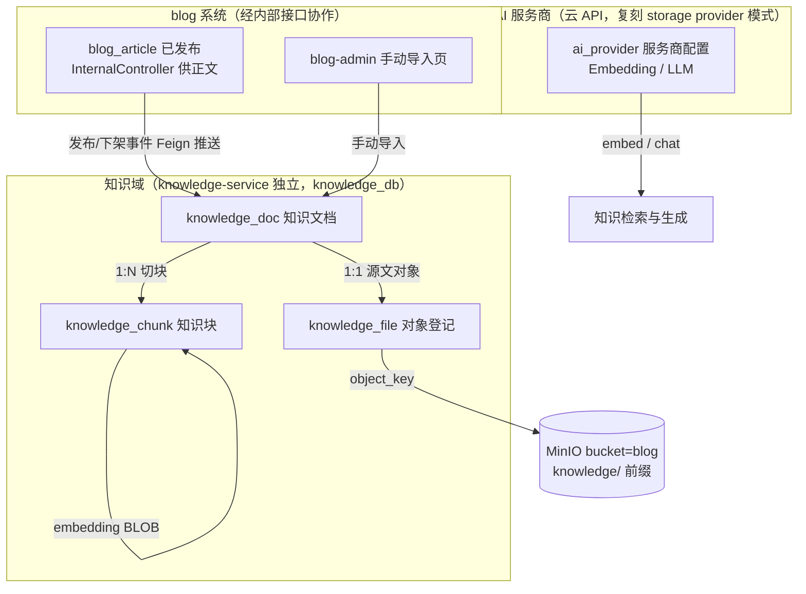

# 知识库 + 向量化 + AI 组织展示 · 设计文档

> 状态：**探索稿 v0.2（部分裁决）**——架构、云 API、手动导入、问答鉴权已裁决；剩余开放问题见 §9；未生成 openspec 提案
> 定位：blog 系统建成后的知识库业务域设计——知识入库、切块、向量化、检索、AI 组织生成
> 前置：`docs/blog-system/`（文章域，知识来源）；`CLAUDE.md`（契约口径唯一源）；`object-storage-design.md`（provider 多服务商模式先例）
> 索引：[README.md](./README.md)

---

## 1. 背景与目标

blog 系统已交付内容域（分类/标签/文章/正文 MinIO/两端前端）。下一阶段引入**知识库**概念：

1. **入库**：将博客沉淀的知识信息（已发布文章）纳入知识库；
2. **向量化**：对知识数据做切块（chunk）+ Embedding，形成可语义检索的向量索引；
3. **AI 组织展示**：后续通过 LLM 对检索到的知识进行组织，以新形态呈现给用户（RAG 问答为核心形态）。

### 1.1 目标（按期建议）

| 期 | 内容 | 价值 |
|----|------|------|
| **P0** | 独立 knowledge-service：文章自动入库 + **手动导入** + 切块 + 向量化（**云 API**）+ 余弦检索 + portal RAG 问答（SSE 流式，**需登录**） | 最小闭环：问知识库，答案有出处 |
| **P1** | 文件导入扩展（PDF/Word 解析）；问答会话记录完善；知识库运维增强 | 知识来源与运营深化 |
| **P2** | 知识地图 / 主题综述 / 相关文章推荐 / 管理端 AI 摘要与自动打标 | AI 组织展示的更多形态 |

### 1.2 非目标（Non-goals，当前期不做）

- 不引入新中间件（pgvector / Milvus / Qdrant / Elasticsearch）——沿用「检索先 DB，量级不够再开变更」的项目既有裁决（见 `docs/blog-system/business-design.md` §1.2）
- 不做通用文档深度解析（PDF/Word 切块解析归 P1 文件导入扩展，视需要再定）
- 不做对话记忆多轮上下文管理之外的聊天产品化（会话记录仅用于审计与展示）
- 不做 Embedding/LLM 模型自托管训练（**已裁决走云 API**，不自建推理服务）
- 不新建独立知识库前端（admin 运维页嵌 blog-admin、问答页嵌 blog-portal，复用登录与菜单体系；知识库长成跨多内容源的独立系统时再拆前端）
- 生产密钥入仓（连接串/账密只查 `docs/test-env.md` / Nacos）

---

## 2. 现状盘点（可复用资产）

| 资产 | 现状 | 知识库如何复用 |
|------|------|---------------|
| 文章正文 | Markdown 存 MinIO（`blog-content/{articleId}/live/{uuid}.md`），经 `sys_file` 登记 | 入库源 A：发布事件推送 → 经 blog 内部接口取正文源文 → 切块 |
| 文章元数据 | `blog_article`（title/summary/category_id）+ `blog_article_tag` | chunk 上下文增强：标题/分类/标签一并编码（经内部接口获取） |
| 多服务商抽象模式 | `sys_storage_provider` + `blog-object-storage` SDK + 连通测试接口 | **照搬该模式**做 `ai_provider`（Embedding/LLM 云 API 服务商配置） |
| 对象存储 SDK | `blog-object-storage` 独立模块（yml `YmlStorageProviderSupplier` 引导） | knowledge-service 直接依赖该 SDK 读写 MinIO（手动导入正文落对象） |
| RBAC / 审计 / 发号 / 幂等 | blog 系统已交付横切能力 | 管理接口挂 blog RBAC 权限位（菜单登记进 blog-admin）；网关透传用户上下文 |
| blog-gateway / blog-service | `/api/**` 路由已通；Feign 内部接口先例（`BlogInternalClient`） | gateway 增路由 `/api/v1/knowledge/**` → knowledge-service；blog-service 经 internal 接口供正文 |
| 前端 | blog-admin(5100 dev) / blog-portal(5200 dev) | admin 加知识库运维菜单；portal 加问答页（**需登录**） |

---

## 3. 总体数据流

```
【① 入库——两个来源】
来源 A（文章，自动）：
  blog-service 发布/重发布(status→1)
   │ Feign 推送 POST knowledge-internal /docs/sync
   │   { source=ARTICLE, sourceId, action=PUBLISH|REPUBLISH|OFFLINE }
   ▼
  knowledge_doc 登记(source=ARTICLE, source_id=articleId, status=PENDING)
   │ 回拉正文：Feign blog internal GET /internal/articles/{id}/content-md
   │   （返回 Markdown 源文 + 标题/分类/标签元数据）
   ▼
来源 B（手动导入，管理员上传文件）：
  blog-admin 知识导入页：点击/拖拽上传 Markdown 文件（.md，支持多选）+ 可选标签
   │ POST /api/v1/admin/knowledge/docs（multipart：file + tags?）
   │ 标题默认取文件名去扩展名；源文 put MinIO knowledge/{docId}/{uuid}.md
   │   + 登记 knowledge_file（original_name 留存上传文件名）
   ▼
  knowledge_doc 登记(source=MANUAL, status=PENDING) → 从 MinIO 读源文
   │
   ▼ 切块（共用）
按标题层级 + 段落聚合，目标 500–800 字/chunk
   ▼
knowledge_chunk 落库(seq/heading/content, embed_status=PENDING)

【② 向量化】（异步任务，逐 chunk，批量调云 API）
knowledge_chunk(embed_status=PENDING)
   │ EmbeddingProvider.embed(texts[])（云 API）
   ▼
embedding 向量(BLOB) + dim + model 回写 chunk，embed_status=READY
   │ 失败 → embed_status=FAILED + fail_reason；可重试/重建
   ▼
doc.status=READY（全部 chunk READY）

【③ 检索 + 生成】（登录用户问答）
问题 q → EmbeddingProvider.embed(q)
   → 应用层余弦相似度 Top-K（K=5 起步，仅 embed_status=READY 且 doc.status=READY）
   → 组装上下文：chunk.content + 出处(标题/链接)
   → LLMProvider.chat(prompt + 上下文, stream=true)（云 API）
   → SSE 流式返回 portal；答案末尾附引用来源列表

【④ 同步治理】
文章下架/重新发布/删除 → blog 推送 OFFLINE/REPUBLISH → doc INVALID/重建
手动导入编辑/删除 → 管理端直接触发重建/失效
管理端「重建索引」→ 全量重切 + 重向量化（换模型/dim 后必需）
```

---

## 4. 领域模型



**核心概念：**

| 概念 | 说明 |
|------|------|
| 知识文档 doc | 一次入库的完整知识单元；P0 两来源：`source=ARTICLE`（已发布文章，自动）/ `source=MANUAL`（手动导入）；P1 扩文件导入 |
| 知识块 chunk | 检索与向量的最小单元；携带 doc 上下文（标题/分类/标签）增强语义 |
| 向量 embedding | 存 `knowledge_chunk` 行内（BLOB），应用层余弦检索；**不**引向量数据库 |
| 知识文件 file | 手动导入源文的对象登记（结构对齐 `sys_file` 裁剪版）；文章正文仍归 blog 的 `sys_file` |
| AI 服务商 provider | Embedding 与 LLM 的**云 API** 服务配置（type/base_url/model/dim/api_key），DB 优先 + yml 引导默认 |

### 4.1 状态机

**doc.status：**

```
PENDING ──切块完成──► VECTORIZING ──全部chunk READY──► READY
   │                     │  任一 chunk FAILED（超阈值）
   └── 失败 ────────────► FAILED（可重试/重建）
READY ──文章下架──► INVALID（向量过滤，不物理删；文章删除随逻辑删）
READY ──手动导入编辑──► 重新 PENDING（内容版本变更触发重建）
```

**chunk.embed_status：** `PENDING → VECTORIZING → READY / FAILED`；FAILED 单块可重试。

---

## 5. 关键选型对比（决策记录）

### 5.1 向量存储（已裁决：MySQL 存向量）

**为何 MySQL（而不是向量数据库）：**

| 理由 | 说明 |
|------|------|
| 项目既有裁决先例 | blog 业务设计 §1.2「检索先 DB，量级不够再开变更」（拒绝 ES 的同一原则套用到向量检索） |
| 量级 | 个人博客 1000 篇 × 20 chunk = 2 万行；1536 维 float32 ≈ 6KB/行，共 120MB；Java 流式余弦全扫预期 <100ms |
| 运维成本 | 测试单机已跑 MySQL/Redis/Nacos/MinIO/Jenkins；pgvector 引入第二种关系库、Milvus 重组件，每加一个组件 = 部署/监控/备份/流水线全套 |
| 事务一致性 | doc 状态机与向量回写**同库同事务**，无跨存储一致性问题 |
| 升级路径 | 拆独立 `knowledge_db` 后，未来迁 pgvector/Milvus 只动知识库一个库一个服务，blog 不受影响 |
| 迁移判据 | chunk >10 万或检索 P95 >500ms 时开变更迁移（表已含 dim/model 字段，有抓手） |

**升级路径候选间的取舍（触发迁移判据时再裁决）：** 纯量级问题选 pgvector（更轻）；需要「语义检索 + 复杂过滤组合」或「BM25 关键词 + 向量混合排序（RRF）」选 ES（`dense_vector` kNN 原生支持，二者独有强项）。**已确认（2026-10-27）：当前量级维持 MySQL，ES 不引入，仅留档为升级路径候选。**

| 方案 | 部署成本 | 检索能力 | 项目契合度 |
|------|---------|---------|-----------|
| **MySQL 存 BLOB + 应用层余弦** ✅ | **零新增** | 暴力检索 O(N·dim)；个人博客量级（≈几千 chunk）毫秒~几十毫秒 | **高**：符合「检索先 DB」既有裁决；单机测试环境 |
| pgvector | 新增 PostgreSQL 组件 | 索引 ANN | 低：引入第二种关系库，运维 +1 |
| Milvus / Qdrant | 重组件、独立部署 | 强 | 低：单机环境过重 |
| Redis RediSearch | 需模块版 Redis | 中 | 低：与既有 Redis 用法（缓存 DB 序号）冲突 |
| Elasticsearch | — | — | **已明确排除**（blog 业务设计 §1.2） |

### 5.2 Embedding / LLM 服务商（已裁决：云 API；默认 SiliconFlow bge-m3 免费额度起步）

**裁决：** 测试服务器可出外网，**采用云 API**；Embedding **首选 SiliconFlow 的 bge-m3（dim=1024）免费额度**。复刻 `sys_storage_provider` 模式（DB 优先 + yml 引导默认 + 连通测试 + 密钥不回显）：

| type 候选 | Embedding 模型（dim） | LLM 模型 | 备注 |
|-----------|----------------------|----------|------|
| **`SILICONFLOW`** ✅ 默认 | **bge-m3（1024）免费额度** | Qwen / GLM / DeepSeek 系列 | 聚合平台；OpenAI 兼容端点；免费额度有限→批量节流 + 失败可重试 |
| `DASHSCOPE` | text-embedding-v3/v4（1024） | qwen-max / qwen-plus | 阿里百炼；OpenAI 兼容端点 |
| `ZHIPU` | embedding-3（2048） | glm-4 系列 | 智谱开放平台 |
| `OPENAI` | text-embedding-3-small（1536） | gpt-4o-mini | 需国际支付渠道 |

**约束：** 同一知识库同一时刻**只允许一个生效 Embedding provider**（dim/model 混存会破坏检索语义）；切换 provider 须走「重建索引」。LLM provider 可独立配置、可多个（生成侧无 dim 约束）。**LLM 厂商未单独裁决**（倾向与 embedding 同用 SiliconFlow 账号，模型名后配，见 §9）。

**引导默认 seed：** `code=siliconflow-default, kind=3(兼容两者), type=SILICONFLOW, model=bge-m3, dim=1024, is_default=1`（base_url/api_key 走 yml 引导 + `docs/test-env.md` 登记）。

### 5.3 架构位置（已裁决：拆独立 knowledge-service，blog 系统适配变动）

**架构总览：**

```
┌─ blog 系统（既有，需适配变动）──────────────────────┐
│ blog-portal(5200)         blog-admin(5100)          │
│  +问知识库页(需登录③)      +知识库运维菜单            │
│        │                       │                     │
│      blog-gateway(9100)        │                     │
│        │ /api/v1/knowledge/** ─┼──────────┐          │
│        │ 其余 /api/**          │          ▼          │
│        ▼                       │    knowledge-service│
│   blog-service(19100) ────────┼──► (19101)          │
│    ①发布/下架事件 Feign 推送 ──┼──► knowledge_db     │
│    ②InternalController 暴露    │    ·doc/chunk/file  │
│      正文元数据读取 ◄──────────┘    ·ai_provider/chat │
│    ③portal 接 auth-center SSO      ·Embedding(云API) │
│                                     ·LLM(SSE 流式)   │
└─────────────────────────────────────────────────────┘
```

| 项 | 取值 | 说明 |
|----|------|------|
| 服务 | **独立 `knowledge-service`，端口 19101**（业务服务扩展段起始，port-registry 已预留规划） | **属于 blog 系统内第 2 个业务服务**（对齐 user 系统一网关多服务形态）；AI 调用（embedding/LLM 长耗时）隔离在独立进程，不拖累 blog-service |
| 库 | **独立 `knowledge_db`**（对齐每系统一库） | `knowledge_doc` / `knowledge_chunk` / `knowledge_file` / `ai_provider` / `knowledge_chat_*` |
| **权限** | **沿用 blog RBAC，不建新权限体系**（已裁决） | 菜单与权限位登记 blog_db（`sys_menu` 等）；knowledge-service 只消费校验结果。现状：blog-service 为进程内 `RbacServiceImpl` 直读 blog_db 校验——knowledge-service 独立进程后的校验链路实现（Feign 调 blog 内部校验接口 vs 网关透传权限）为实施细节，提案时按 blog 现行模式对齐定稿 |
| 网关 | **复用 blog-gateway(9100)** 增路由 `/api/v1/knowledge/**` → knowledge-service | 避免新建网关 + 重复鉴权配置；知识库长成独立系统时再申请 9101 |
| 前端 | admin 运维页嵌 **blog-admin**；问答页嵌 **blog-portal** | 复用登录态与菜单体系，不建独立前端 |
| 模块 | `backend/knowledge/`：`knowledge-service`（起步单体，含 common；规模上来再拆 api/framework） | 最小模块集；不预建空壳模块 |
| 依赖 | `blog-object-storage` SDK（直读写 MinIO）+ `blog-api` Feign（拉文章正文） | 两个既有模块直接复用 |

**blog 系统适配变动清单（「原 blog 系统的架构需要变动」落点）：**

| # | 变动 | 内容 |
|---|------|------|
| ① | **发布事件推送** | blog-service 发布/下架/重发布/删除后，Feign 调 knowledge 内部接口 `POST /internal/knowledge/docs/sync`（幂等，失败不阻断业务、记日志待补偿）；推送失败由管理端「同步对账/重建索引」兜底 |
| ② | **内部接口暴露正文** | `blog-api` 的 `BlogInternalClient` 增 `GET /internal/articles/{id}/knowledge-content`：返回 Markdown 源文 + 标题/分类/标签元数据（只读，无状态变更） |
| ③ | **portal 登录接入** | blog-portal 接 auth-center OIDC SPA 登录（新增 client_id 如 `blog-portal-spa`，redirect 5200/callback，对齐 user-admin-spa 先例）；问答接口走登录态（`/api/v1/knowledge/**` 非公开前缀，网关 JWT 鉴权） |
| ④ | **gateway 路由与透传** | blog-gateway 增 knowledge 路由；`/api/v1/knowledge/**` 不入 public-paths（需登录）；用户头透传沿用既有 UserHeaderFilter |

### 5.4 入库触发（已定）

- 文章**发布/重发布**→ Feign 推送 → 异步入库向量化；**下架**→ doc INVALID；**删除**→ doc INVALID（随文章逻辑删）
- 手动导入：上传文件即入库；重新上传（内容版本变更）→ 触发重建；删除 → 逻辑删 + doc INVALID
- 不引 MQ；Feign 推送 + 任务表驱动（`embed_status=PENDING` 即待办），失败可补偿重试（管理端单文档重试 + 全量重建）

---

## 6. 库表草案（探索稿，字段级契约待正式设计定稿）

> 归属**独立 `knowledge_db`**（`deploy/db/migration/knowledge_db/`）。约定沿用 blog 域：snake_case、16 位发号主键（id 对外 String）、无物理外键、审计字段齐套（`CLAUDE.md` §6.4.5）。

### 6.1 `knowledge_doc` 知识文档

| 字段 | 类型 | 空 | 默认 | 说明 |
|------|------|----|------|------|
| id | BIGINT | N | 发号 | 主键 |
| source | TINYINT | N | | 1=文章 / 2=手动导入（**P0 两来源**）/ 3=文件导入（P1 预留） |
| source_id | BIGINT | N | 0 | 来源业务 id（source=1 时 = `blog_article.id`；source=2 时 0） |
| title | VARCHAR(200) | N | | 知识标题（文章场景快照文章标题；手动导入默认取上传文件名去扩展名，可后改） |
| content_version | VARCHAR(64) | N | '' | 内容版本指纹（文章=live `sys_file.id`；手动导入=源文 `knowledge_file.id`）；变更即触发重建 |
| file_id | BIGINT | N | 0 | 手动导入源文件（.md）→ `knowledge_file.id`（source=2 时必填；文章来源 0，正文经 blog 内部接口取） |
| tags | VARCHAR(255) | N | '' | 手动导入可选标签（逗号分隔；文章来源快照文章标签） |
| status | TINYINT | N | 0 | 0 PENDING / 1 VECTORIZING / 2 READY / 3 FAILED / 4 INVALID |
| chunk_count | INT | N | 0 | 切块数（READY 口径） |
| embed_model | VARCHAR(64) | N | '' | 向量化时使用的 embedding 模型（重建后覆盖） |
| embed_dim | INT | N | 0 | 向量维度 |
| 审计字段 | | | | 同约定 |

- 索引：`uk_knowledge_doc_source(source, source_id)`（source=2 时 source_id=id 兜底唯一）、`idx_knowledge_doc_status(status)`

### 6.2 `knowledge_chunk` 知识块

| 字段 | 类型 | 空 | 默认 | 说明 |
|------|------|----|------|------|
| id | BIGINT | N | 发号 | 主键 |
| doc_id | BIGINT | N | | → `knowledge_doc.id` |
| seq | INT | N | 0 | 块序号（文档内顺序） |
| heading | VARCHAR(200) | N | '' | 所属标题链（如「## 性能 > ### 缓存」） |
| content | TEXT | N | | 块文本（含上下文增强：标题/分类/标签前缀） |
| token_count | INT | N | 0 | 估算 token 数（展示用） |
| embedding | BLOB | NULL | NULL | float32 数组小端序；NULL=未向量化 |
| embed_status | TINYINT | N | 0 | 0 PENDING / 1 VECTORIZING / 2 READY / 3 FAILED |
| fail_reason | VARCHAR(500) | N | '' | 失败原因（provider/错误码） |
| 审计字段 | | | | 同约定 |

- 索引：`idx_knowledge_chunk_doc(doc_id, seq)`、`idx_knowledge_chunk_status(embed_status)`
- **不**建 `embedding` 上的索引（应用层全扫）；`content` 只存增强后文本，出处反查经 doc → article

### 6.3 `knowledge_file` 知识对象登记（手动导入源文，结构对齐 `sys_file` 裁剪）

| 字段 | 类型 | 空 | 默认 | 说明 |
|------|------|----|------|------|
| id | BIGINT | N | 发号 | 主键 |
| bucket | VARCHAR(64) | N | | 桶（共用 `blog` 桶） |
| object_key | VARCHAR(255) | N | | `knowledge/{docId}/{uuid}.md`（MIME `text/markdown`） |
| original_name | VARCHAR(255) | N | '' | 上传原始文件名（留档；标题默认取文件名去扩展名） |
| mime_type | VARCHAR(64) | N | | `text/markdown` |
| file_size | BIGINT | N | 0 | 字节数（仅展示用；**不设业务大小上限**，网关/服务器层限额兜底） |
| biz_type | VARCHAR(32) | N | | `KNOWLEDGE_SOURCE` |
| biz_id | BIGINT | N | 0 | → `knowledge_doc.id` |
| storage_code | VARCHAR(32) | N | | 存储服务商 code（对齐 `blog.object-storage.providers[]` 配置） |
| 审计字段 | | | | 同约定；`deleted=1` 逻辑删 |

- 索引：`idx_knowledge_file_biz(biz_type, biz_id)`、`idx_knowledge_file_key(object_key)`
- 文章正文**不**落此表（归 blog 的 `sys_file`，经内部接口取）；本表只登记手动导入源文
- **写入铁律沿用：** put MinIO 必须 INSERT 本表；业务表（doc）不裸存 object_key

### 6.4 `ai_provider` AI 服务商配置（复刻 `sys_storage_provider`）

| 字段 | 类型 | 空 | 默认 | 说明 |
|------|------|----|------|------|
| id | BIGINT | N | 发号 | 主键 |
| code | VARCHAR(32) | N | | 服务商标识（如 `siliconflow-default`） |
| kind | TINYINT | N | | 1=Embedding / 2=LLM / 3=兼容两者（OpenAI 兼容端点） |
| type | VARCHAR(32) | N | | `SILICONFLOW` / `DASHSCOPE` / `ZHIPU` / `OPENAI`（云 API） |
| name | VARCHAR(64) | N | | 显示名 |
| base_url | VARCHAR(255) | N | | 云 API 端点 |
| model | VARCHAR(64) | N | | 模型名（embedding 或 chat 模型） |
| dim | INT | N | 0 | 向量维度（kind 含 Embedding 时必填） |
| api_key | VARCHAR(512) | N | '' | dev/test 明文落库（对齐 SK 处理现状）；生产加密另开变更 |
| is_default | TINYINT | N | 0 | kind 维度唯一默认（Embedding 同时最多一个生效默认） |
| status | TINYINT | N | 1 | 1 启用 / 0 停用 |
| 审计字段 | | | | 同约定 |

- 索引：`uk_ai_provider_code(code)`（仅 is_default=1 的唯一性由应用层保证，MySQL 无条件唯一索引）

### 6.5 `knowledge_chat_*` 问答记录（P0 最小形态，待定稿）

- `knowledge_chat_session`：id、create_by（**登录用户 id，问答不允许匿名**）、审计字段
- `knowledge_chat_message`：session_id、role（Q/A）、content、refs（JSON：引用 chunk/文档列表）、耗时、审计字段

---

## 7. 接口草案（探索稿）

> 路由统一经 blog-gateway(9100) `/api/v1/knowledge/**` → knowledge-service(19101)。

### 7.1 管理端（`/api/v1/admin/knowledge/**`，挂权限 + 审计）

| 接口 | 说明 |
|------|------|
| `GET /admin/knowledge/docs` | 知识文档分页（status/来源筛选，含 chunk/向量健康度） |
| `POST /admin/knowledge/docs` | **手动导入（文件上传）**：multipart（`file`：.md，可多文件逐个调；`tags?`）→ put MinIO + 登记 knowledge_file（original_name=上传文件名）→ doc(source=MANUAL, PENDING)，标题默认=文件名去扩展名；不设业务大小上限 |
| `PUT /admin/knowledge/docs/{id}` | 编辑手动导入：重新上传文件（multipart，content_version 变更触发重建）或改 tags |
| `DELETE /admin/knowledge/docs/{id}` | 逻辑删（doc INVALID + chunk 失效；仅 source=MANUAL） |
| `POST /admin/knowledge/docs/{id}/revectorize` | 单文档重建（重切+重向量化） |
| `POST /admin/knowledge/reindex` | 全量重建（换 provider/model 后） |
| `POST /admin/knowledge/sync-articles` | 对账补偿：拉取 blog 已发布文章 diff 补推（Feign 推送失败的兜底） |
| `GET /admin/knowledge/stats` | 统计：doc/chunk 数、READY 比例、各 provider 调用量 |
| `GET/POST/PUT/DELETE /admin/knowledge/ai-providers` | AI 服务商 CRUD + `POST /{id}/test` 连通测试（对齐 storage-provider 交互模式） |

权限位（对齐 `system:resource:action` 格式，登记进 blog 菜单表）：`blog:knowledge:list / create / update / delete / reindex / manage`、`blog:ai-provider:list / create / update / delete / test`。

### 7.2 用户端（`/api/v1/knowledge/ask`，**登录用户**，非公开前缀）

| 接口 | 说明 |
|------|------|
| `POST /knowledge/ask`（SSE） | 入参 `{ question, sessionId? }`；**网关 JWT 鉴权，登录用户可问**；流式返回答案 + 末尾 `refs[]`（文档标题/链接/命中片段；文章来源跳 portal 详情，手动导入标「知识条目」） |
| `GET /knowledge/related/{articleId}`（P2） | 基于向量相似的相关文章推荐 |

**限流：** 问答为外部付费调用，登录用户配额限流（如 20 次/天/用户 + 5 次/分钟/用户，`@RateLimit`）；**无匿名通道**（已裁决）。

### 7.3 内部接口（`/internal/**`，仅服务间，不进网关）

| 接口 | 说明 |
|------|------|
| knowledge-service：`POST /internal/knowledge/docs/sync` | blog-service 推送文章事件（PUBLISH/REPUBLISH/OFFLINE/DELETE）；幂等；失败不阻断 blog 业务 |
| knowledge-service：`GET /internal/knowledge/health` | 服务健康（供 blog 对账/运维探测） |
| blog-service：`GET /internal/articles/{id}/knowledge-content`（既有 blog 内部接口扩展） | 返回 Markdown 源文 + 标题/分类/标签元数据（只读） |

**依赖方向：** knowledge-service → blog-api（拉正文）；blog-service → knowledge-api（事件推送）→ 需新建 `knowledge-api` 模块（Feign client + fallback，对齐 BlogInternalClient 模式）。

---

## 8. 实施切期（建议，待提案时转 tasks）

| 期 | 内容 |
|----|------|
| P0-1 | `backend/knowledge/` 骨架 + knowledge-service(19101) + knowledge_db 库表 SQL + port-registry/test-env 登记 |
| P0-2 | `ai_provider` 配置（引导默认 `siliconflow-default`：bge-m3, dim=1024）+ EmbeddingProvider/LLMProvider 抽象（云 API，含连通测试） |
| P0-3 | blog 适配①②：`BlogInternalClient` 扩 knowledge-content 内部接口；发布/下架事件 Feign 推送（`knowledge-api` 模块） |
| P0-4 | 切块器 + 异步向量化任务（状态机 + 重试）+ 文章入库链路 |
| P0-5 | **手动导入**：管理端 .md 文件上传（多选/拖拽）/重新上传/删除 + MinIO 源文 + knowledge_file 登记 |
| P0-6 | 余弦检索 + RAG prompt 组装 + SSE 问答接口 + 登录用户限流 |
| P0-7 | blog 适配③④：blog-portal 接 auth-center SSO 登录；blog-gateway 增 knowledge 路由 |
| P0-8 | blog-admin 知识库运维菜单（列表/手动导入页/重建/统计/provider 管理） |
| P0-9 | blog-portal 问答页（登录态 + 流式 UI + 引用展示） |
| P1 | 文件导入扩展（PDF/Word 解析）；问答会话记录完善 |
| P2 | 知识地图/综述/相关推荐/自动打标 |

---

## 9. 开放问题清单（剩余待裁决，裁决后回写本文档）

**已裁决（2026-10-27）：** 向量存储=MySQL（理由见 §5.1）｜架构=独立 knowledge-service（**blog 系统内服务**）+ blog 适配变动｜云 API，Embedding=**SiliconFlow bge-m3 免费额度**（dim=1024）｜手动导入进 P0｜问答不允许匿名｜**权限沿用 blog RBAC**（不建新体系）。

| # | 问题 | 影响 | 当前倾向 |
|---|------|------|---------|
| Q1 | **LLM 厂商与模型**：生成侧用哪家哪个模型（Qwen / GLM / DeepSeek 系）？ | `ai_provider` kind=LLM 配置、问答成本 | 与 embedding 同用 SiliconFlow 账号，模型先用便宜档（如 Qwen 小尺寸），效果不够再升 |
| Q2 | **SSE 流式透传**：blog-gateway（Spring Cloud Gateway）对 SSE 的超时/缓冲需确认配置 | 接口形态（降级方案：非流式一次性返回） | 待 PoC 验证 |
| Q3 | **切块参数**：500–800 字/chunk、上下文增强前缀格式——首版取值 | 检索质量 | 首版按建议值，落地后按效果调 |
| Q4 | **portal SSO client**：`blog-portal-spa` 的注册（auth-center 种子）与回调路由细节 | P0-7 | 对齐 user-admin-spa 先例，实施时登记 |

> **流程约定：** 未获用户明确指示不发起 openspec 提案；本目录文档独立演进，提案时点由用户决定。

---

## 10. 裁决记录

| 日期 | 决策 | 依据 |
|------|------|------|
| 2026-10-27 | 探索稿建立：MySQL 存向量（应用层余弦）、provider 复刻 storage 模式 | 对齐「检索先 DB」既有裁决与单机环境约束 |
| 2026-10-27 | **向量存储 = MySQL**（用户确认，理由留档 §5.1） | 量级测算 + 零新增组件 + 同库事务 + 拆库后迁移路径干净 |
| 2026-10-27 | **架构 = 独立 knowledge-service(19101) + knowledge_db**，blog 系统适配变动（事件推送/内部接口/portal SSO/gateway 路由）；网关复用 blog-gateway、前端嵌两端 | 用户裁决「拆专门知识库模块，blog 架构变动」 |
| 2026-10-27 | **Embedding/LLM = 云 API**（服务器可出外网） | 用户裁决；厂商待定（开放问题 Q1） |
| 2026-10-27 | **手动导入进 P0**（source=MANUAL，源文落 MinIO + knowledge_file 登记） | 用户裁决 |
| 2026-10-27 | **问答不允许匿名**（portal 登录用户可问，配额限流） | 用户裁决；带动 blog-portal 接 auth-center SSO |
| 2026-10-27 | **Embedding = SiliconFlow bge-m3（dim=1024）免费额度起步**；引导默认 seed `siliconflow-default` | 用户裁决「先使用 bge-m3 embedding 免费额度」；免费额度有限→向量化批量节流 + 失败重试 |
| 2026-10-27 | **权限沿用 blog RBAC，不建新体系**；knowledge-service 为 **blog 系统内**第 2 个业务服务 | 用户裁决「knowledge-service 还是在 blog 系统内」；菜单/权限位登记 blog_db；跨进程校验链路为实施细节 |
| 2026-10-27 | **流程：未获明确指示不创建 openspec 提案** | 用户指示；设计文档独立演进 |
| 2026-10-27 | **向量存储维持 MySQL**（重议 ES 后确认不引入）：ES 能力（dense_vector kNN/过滤/混合检索）认可，但当前量级（≈2 万 chunk 全扫 <100ms）不值引入最重中间件；ES 与 pgvector 并列留档升级路径候选，取舍判据见 §5.1 | 用户裁决「维持现状」 |