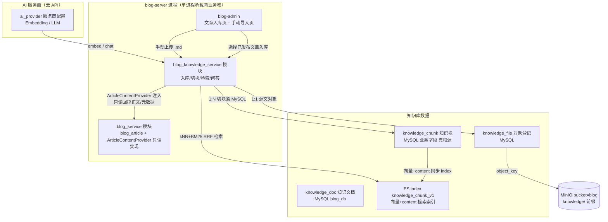

# 知识库 + 向量化 + AI 组织展示 · 设计文档

> 状态：**探索稿 v0.5（开放问题清零）**——单进程架构、ES 向量检索、云 API、手动导入、问答鉴权已裁决；开放问题 Q1-Q11 已全部裁决（2026-10-27/28）；**openspec 提案已发起：`openspec/changes/blog-knowledge-base/`（2026-10-28）**
> 定位：blog 系统建成后的知识库业务域设计——知识入库、切块、向量化、检索、AI 组织生成
> 前置：`docs/blog-system/`（文章域，知识来源）；`CLAUDE.md`（契约口径唯一源）；`object-storage-design.md`（provider 多服务商模式先例）
> 索引：[README.md](./README.md)

---

## 1. 背景与目标

blog 系统已交付内容域（分类/标签/文章/正文 MinIO/两端前端）。下一阶段引入**知识库**概念：

1. **入库**：将博客沉淀的知识信息（已发布文章）纳入知识库；
2. **向量化**：对知识数据做切块（chunk）+ Embedding，形成可语义检索的向量索引；
3. **AI 组织展示**：后续通过 LLM 对检索到的知识进行组织，以新形态呈现给用户（RAG 问答为核心形态）。

### 1.1 目标（按期建议）

| 期 | 内容 | 价值 |
|----|------|------|
| **P0** | 知识库业务模块 `blog-knowledge-service`（复用 `blog-server` 启动，单进程承载）+ **Elasticsearch 向量检索**：**管理端选择文章入库**（独立菜单，手动触发）+ **手动导入** + 切块 + 向量化（**云 API**）+ ES kNN + BM25 RRF 混合检索 + portal RAG 问答（SSE 流式，**需登录**） | 最小闭环：问知识库，答案有出处；ES 原生混合检索（精确术语 + 语义双优）；**blog 既有逻辑零改动** |
| **P1** | 文件导入扩展（PDF/Word 解析）；问答会话记录完善；知识库运维增强 | 知识来源与运营深化 |
| **P2** | 知识地图 / 主题综述 / 相关文章推荐 / 管理端 AI 摘要与自动打标 | AI 组织展示的更多形态 |

### 1.2 非目标（Non-goals，当前期不做）

- 不引入 pgvector / Milvus / Qdrant（向量检索用 ES，见 §5.1）
- **ES 仅用于 knowledge 向量+全文混合检索，不扩展到 blog 业务检索**（blog 文章列表/分类/标签检索仍走 MySQL，保持既有裁决；ES 边界限定知识库一个 index）
- 不做通用文档深度解析（PDF/Word 切块解析归 P1 文件导入扩展，视需要再定）
- 不做对话记忆多轮上下文管理之外的聊天产品化（会话记录仅用于审计与展示）
- 不做 Embedding/LLM 模型自托管训练（**已裁决走云 API**，不自建推理服务）
- **不拆 knowledge 独立进程/独立启动模块**（已裁决，见 §5.3）：knowledge 作为 `blog-knowledge-service` 业务模块，复用 `blog-server` 启动；AI 调用（embedding/LLM 长耗时）在进程内经独立线程池隔离 + 超时控制；当前量级进程内隔离足够
- 不新建独立知识库前端（admin 运维页嵌 blog-admin、问答页嵌 blog-portal，复用登录与菜单体系）
- 生产密钥入仓（连接串/账密只查 `docs/test-env.md` / Nacos）

---

## 2. 现状盘点（可复用资产）

| 资产 | 现状 | 知识库如何复用 |
|------|------|---------------|
| 文章正文 | Markdown 存 MinIO（`blog-content/{articleId}/live/{uuid}.md`），经 `sys_file` 登记 | 入库源 A：**管理端选择已发布文章** → 只读契约取正文源文 → 切块 |
| 文章元数据 | `blog_article`（title/summary/category_id）+ `blog_article_tag` | chunk 上下文增强：标题/分类/标签一并编码（只读契约获取） |
| 多服务商抽象模式 | `sys_storage_provider` + `blog-object-storage` SDK + 连通测试接口 | **照搬该模式**做 `ai_provider`（Embedding/LLM 云 API 服务商配置） |
| 对象存储 SDK | `blog-object-storage` 独立模块（yml `YmlStorageProviderSupplier` 引导） | `blog-knowledge-service` 直接依赖该 SDK 读写 MinIO（手动导入正文落对象） |
| RBAC / 审计 / 发号 / 幂等 | blog 系统已交付横切能力 | 管理接口挂 blog RBAC 权限位；**同进程**直接复用 `RbacServiceImpl`，无跨进程校验链路问题 |
| blog-server 启动范式 | blog 已落地「启动模块 `blog-server` + 业务模块 `blog-service`」分离（`openspec/changes/blog-server-module-split/`） | knowledge 复用：`blog-server` 增依赖 `blog-knowledge-service`，同一进程承载两业务域 |
| Elasticsearch（**新引入**） | 项目原未引入 ES（排除出处为 blog 业务设计 §1.2「检索先 DB」原则；**不在 CLAUDE.md §2.2 清单**） | knowledge 向量+全文混合检索唯一落点（index `knowledge_chunk_v1`）；按 CLAUDE.md §2「新增选型先改技术栈表」流程已登记（见裁决记录 2026-10-28） |
| 前端 | blog-admin(5100 dev) / blog-portal(5200 dev) | admin 加知识库运维菜单；portal 加问答页（**需登录**） |

---

## 3. 总体数据流

```
【① 入库——两个来源，均为管理端手动触发（**不改 blog 既有逻辑**）】
来源 A（文章，**管理端选择入库**）：
  blog-admin「文章入库」页：候选列表由**薄投影表 `knowledge_article_index`** 驱动（先经只读契约同步已发布文章）
   │ 标注 ingestState：未入库 / 已入库 / 待更新 / 已失效（+ docStatus 向量化进度）
   │ 勾选若干文章 → POST /api/v1/admin/knowledge/docs/from-articles（articleIds[]）
   ▼
  blog-knowledge-service 写入 knowledge_task(INGEST) 并投递
   │ knowledge_doc upsert(source=ARTICLE, source_id=articleId, status=PENDING)
   │   （已存在则复用同一 doc 行：content_version 未变 → 跳过并提示「已入库」）
   │ 回拉正文：**只读契约** ArticleContentProvider 取 Markdown 源文 + 标题/分类/标签
   ▼
来源 B（手动导入，管理员上传文件）：
  blog-admin 知识导入页：点击/拖拽上传 Markdown 文件（.md，支持多选）+ 可选标签
   │ POST /api/v1/admin/knowledge/docs（multipart：file + tags?）
   │ 标题默认取文件名去扩展名；源文 put MinIO knowledge/{docId}/{uuid}.md
   │   + 登记 knowledge_file（original_name 留存上传文件名）
   ▼
  knowledge_doc 登记(source=MANUAL, status=PENDING) → 从 MinIO 读源文
   │
   ▼ 切块（共用）
按标题层级 + 段落聚合，目标 500–800 字/chunk（已裁决 Q3：首版按建议值，落地后调）
   ▼
knowledge_chunk 落 MySQL(seq/heading/content, embed_status=PENDING)

【② 向量化 + 入 ES 索引】（异步任务，逐 chunk，批量调云 API，独立线程池）
knowledge_chunk(embed_status=PENDING)
   │ EmbeddingProvider.embed(texts[])（云 API）
   ▼
向量(1024 维) + content + 元数据 → index 进 ES knowledge_chunk_v1
   │ MySQL chunk.embed_status=READY（ES index 成功后回写）
   │ 失败 → embed_status=FAILED + fail_reason；可重试/重建
   ▼
doc.status=READY（全部 chunk READY 且 ES index 完成）

【③ 检索 + 生成】（登录用户问答，独立线程池承载 LLM 流式）
问题 q → EmbeddingProvider.embed(q)
   → ES 检索：knn(embedding, q) + match(content, q, BM25) + filter(doc_status=READY)
     → RRF 融合两路排名 → Top-K（K=5 起步，含 content + doc_title + doc_url，无需回 MySQL）
   → 组装上下文：chunk.content + 出处（取自 ES denormalize 的 doc_title/doc_url，全链路不回 MySQL）
   → LLMProvider.chat(prompt + 上下文, stream=true)（云 API）
   → SSE 流式返回 portal；答案末尾附引用来源列表

【④ 同步治理——全部由管理端/对账触发，无自动事件】
文章下架/删除 → **管理端「失效」按钮或对账同步** → doc INVALID，ES 文档 doc_status 置 4[INVALID]（不物理删，检索 filter 排除）
文章重发布（正文变更）→ 管理端「文章入库」页识别为「待更新」→ 重新入库（复用 doc 行，重建）
手动导入编辑/删除 → 管理端触发重建/失效 + ES 同步
管理端「重建索引」→ 删 ES index 重建 + MySQL embed_status 全重置 + 重切重向量化
兜底：管理端对账（`article-index/sync` + 失败任务重跑）覆盖漂移与漏做
```

---

## 4. 领域模型



**核心概念：**

| 概念 | 说明 |
|------|------|
| 知识文档 doc | 一次入库的完整知识单元；P0 两来源：`source=ARTICLE`（**管理端选择已发布文章，手动触发**）/ `source=MANUAL`（手动导入）；P1 扩文件导入 |
| 知识块 chunk | 切块的最小单元；**业务字段（content/heading/seq/embed_status）存 MySQL 为真相源，向量+content 镜像存 ES 为检索索引** |
| 向量 embedding | **存 ES index `knowledge_chunk_v1` 的 `dense_vector` 字段**（1024 维，cosine，HNSW）；MySQL chunk 表不再存 BLOB |
| 知识文件 file | 手动导入源文的对象登记（结构对齐 `sys_file` 裁剪版）；文章正文仍归 blog 的 `sys_file` |
| AI 服务商 provider | Embedding 与 LLM 的**云 API** 服务配置（type/base_url/model/dim/api_key），DB 优先 + yml 引导默认 |
| ES 检索索引 | `knowledge_chunk_v1` index：chunk_id + doc_id + heading(text) + content(text, BM25) + embedding(dense_vector) + source/tags/doc_status + **doc_title/doc_url（denormalize，出处问答无需回 MySQL）**；原生 kNN + match + RRF |
| 同进程只读契约 | `ArticleContentProvider` 接口（blog-knowledge-api 定义，blog-service 只读实现：候选文章分页 + 正文/元数据回拉）；**不引入事件**，blog 既有逻辑零改动；未来拆独立进程时切 Feign |

### 4.1 状态机

**doc.status：**

```
PENDING ──切块完成──► VECTORIZING ──全部chunk READY且ES index完成──► READY
   │                     │  任一 chunk FAILED（超阈值）
   └── 失败 ────────────► FAILED（可重试/重建）
READY ──管理端「失效」（文章下架/删除）──► INVALID（ES 文档 doc_status 置 4[INVALID]，检索 filter 排除；不物理删）
READY ──文章重发布（「待更新」）重新入库──► 复用 doc 行 → 重新 PENDING（content_version 变更触发重建）
READY ──手动导入编辑──► 重新 PENDING（内容版本变更触发重建）
```

**chunk.embed_status：** `PENDING → VECTORIZING → READY / FAILED`；READY 口径 = 向量生成 + ES index 成功；FAILED 单块可重试。

---

## 5. 关键选型对比（决策记录）

### 5.1 向量存储（已裁决：Elasticsearch）

**裁决（2026-10-27 纠正）：** 向量检索改用 **Elasticsearch**（推翻早前"MySQL 存 BLOB + 应用层余弦"方案）。ES 同时承载 dense_vector kNN（语义检索）+ text match BM25（关键词检索），原生 RRF 融合，是"混合检索质量"诉求下的不可替代方案。

> **修订（2026-10-29）：** ES 原生 RRF（`rank.rrf`）属**铂金 license** 功能，basic license 直接 `security_exception`（实测）。检索实现改为 **kNN + BM25 双查询 + 应用层 RRF 融合**（k=60，与原 `rankConstant` 对齐）：融合位置从 ES 移到应用层，检索质量与语义不变，去掉 license 依赖；ES 选型结论不受影响。

**为何 ES：**

| 理由 | 说明 |
|------|------|
| 原生混合检索（RRF） | ES 一条 DSL 内同时 kNN + match + RRF 融合；MySQL/pgvector 需应用层自己拆两路 + 算 RRF，性能与实现成本差 |
| 精确术语召回 | 知识库内容多技术文档（端口号/表名/类名/配置键），纯向量对这类精确查询召回弱；BM25 字面匹配补足 |
| 检索性能与扩展性 | HNSW ANN 索引 O(logN)，chunk 增长到几十万级检索 P95 仍 <50ms；MySQL 暴力全扫有天花板 |
| 复杂过滤 | 检索叠加 filter（doc.status/source/tags 组合），ES bool query 强 |
| 单进程架构下的边界隔离 | ES 仅一个 index `knowledge_chunk_v1`，不扩 blog 业务检索，边界清晰 |

**代价与对策：**

| 代价 | 对策 |
|------|------|
| 新增组件选型流程（CLAUDE.md §2「新增选型先改技术栈表」） | **已裁决（Q8）**：§2 技术栈表新增 ES 行（边界注明仅 knowledge 域）；ES **不在 §2.2「明确不引入」清单**（早前引用 §2.2 有误，已修正）；同步 version-baseline/test-env 登记 |
| 运维成本（ES 是最重中间件，JVM 2-4GB 堆） | 测试单机部署单节点 ES（开发/测试够用）；生产评估集群；快照备份 index |
| 双写一致性（MySQL chunk + ES index） | MySQL 为真相源，ES 异步 index；chunk content 不常变（仅重建时变），一致性可控；doc 状态变更更新/删 ES 文档由任务驱动 + 对账补偿 |
| 中文分词（BM25 需 analyzer） | **已裁决（Q10）：P0 装 ik 分词器**，`content`/`heading` 用 `ik_smart`（`ik_max_word` 留 P1 对比调优）；插件版本随 ES 服务端对齐 |

**升级/回退路径：** ES 即终态向量存储方案，无进一步迁移。若 ES 运维不可承受，可回退 MySQL BLOB + 应用层余弦（chunk 表保留 embed_model/dim 字段作回退抓手，但 embedding BLOB 需在回退时加回）。

| 方案 | 部署成本 | 检索能力 | 项目契合度 |
|------|---------|---------|-----------|
| **Elasticsearch**（dense_vector kNN + BM25 + RRF）✅ | 新增 ES 组件 | HNSW ANN + 关键词 + 混合融合，全量级 | **中**：新增选型已按 CLAUDE.md §2 流程登记技术栈（裁决 2026-10-28）；ES 边界限 knowledge 一个 index |
| MySQL 存 BLOB + 应用层余弦（已推翻） | 零新增 | 暴力 O(N·dim)，无 BM25/RRF | 曾裁决但检索质量诉求下放弃 |
| pgvector | 新增 PostgreSQL | HNSW ANN，无 BM25/RRF | 无混合检索优势，不如 ES |

### 5.2 Embedding / LLM 服务商（已裁决：云 API；默认 SiliconFlow bge-m3 免费额度起步）

**裁决：** 测试服务器可出外网，**采用云 API**；Embedding **首选 SiliconFlow 的 bge-m3（dim=1024）免费额度**。复刻 `sys_storage_provider` 模式（DB 优先 + yml 引导默认 + 连通测试 + 密钥不回显）：

| type 候选 | Embedding 模型（dim） | LLM 模型 | 备注 |
|-----------|----------------------|----------|------|
| **`SILICONFLOW`** ✅ 默认 | **bge-m3（1024）免费额度** | Qwen / GLM / DeepSeek 系列 | 聚合平台；OpenAI 兼容端点；免费额度有限→批量节流 + 失败可重试 |
| `DASHSCOPE` | text-embedding-v3/v4（1024） | qwen-max / qwen-plus | 阿里百炼；OpenAI 兼容端点 |
| `ZHIPU` | embedding-3（2048） | glm-4 系列 | 智谱开放平台 |
| `OPENAI` | text-embedding-3-small（1536） | gpt-4o-mini | 需国际支付渠道 |

**约束：** 同一知识库同一时刻**只允许一个生效 Embedding provider**（dim/model 混存会破坏检索语义）；切换 provider 须走「重建索引」（删 ES index 重建 + MySQL 重置）。LLM provider 可独立配置、可多个。**LLM 已裁决（Q1，2026-10-28）：与 embedding 同用 SiliconFlow 账号，便宜档起步**；具体型号 P0-2 接入时按当时在售清单 + 免费额度余量锁定并回填 `docs/test-env.md`。

**引导默认 seed（已裁决拆两行，见 [table-design.md](./table-design.md) §5 裁决 5）：** `code=siliconflow-embed, kind=1, type=SILICONFLOW, model=BAAI/bge-m3, dim=1024, is_default=1` **+** `code=siliconflow-llm, kind=2, type=SILICONFLOW, is_default=1`（`model` 为单列，无法同时承载 Embedding 与 LLM 两个模型；`kind=3`「兼容」语义保留但首版不用）；base_url/api_key 走 yml 引导 + `docs/test-env.md` 登记。

### 5.3 架构位置（已裁决：单进程，blog-server 承载 blog-service + blog-knowledge-service）

**架构总览：**

```
┌─ blog 系统（单进程承载两业务域）──────────────────────────┐
│ blog-portal(5200)              blog-admin(5100)           │
│  +问知识库页(需登录③)          +知识库运维菜单(含文章入库)  │
│        │                            │                       │
│      blog-gateway(9100)            │                       │
│        │ /api/v1/knowledge/** ──────┼─────┐                │
│        │ 其余 /api/**                │     │                │
│        ▼                              ▼     ▼                │
│   ┌──────────────────────────────────────────────────┐    │
│   │ blog-server 进程（19100，服务名 blog-service）   │    │
│   │  ┌─────────────────┐   ┌──────────────────────┐ │    │
│   │  │ blog-service 模块 │   │ blog-knowledge-svc  │ │    │
│   │  │ 文章/分类/标签    │──►│ 知识库业务           │ │    │
│   │  │ 站点配置/RBAC     │只读 │ 入库/切块/检索/问答   │ │    │
│   │  └─────────────────┘   └──────────┬───────────┘ │    │
│   │  ①选择入库(管理端触发) ②Provider只读 │             │    │
│   │  ③portal SSO  ④gateway 路由         │ kNN+RRF     │    │
│   │  AI 调用独立线程池隔离              ▼             │    │
│   └──────────────────────────────────┼──────────────┘    │
│     blog_db（含 knowledge_* 表）     │                   │
│   (文章/sys_file/doc/chunk/file/    │ index              │
│    ai_provider/chat/task)           ▼                   │
│                              Elasticsearch（知识库检索）   │
│                              index: knowledge_chunk_v1    │
│                       ▼                                    │
│                   云 API（SiliconFlow bge-m3 + LLM）       │
└──────────────────────────────────────────────────────────┘
```

> **架构裁决要点：** `blog-server`（blog 系统唯一启动模块）依赖 `blog-service` + `blog-knowledge-service`，单进程、单 Nacos 服务（`blog-service`，19100）。knowledge 非独立部署。AI 调用进程内独立线程池隔离。向量+content 检索走 **ES**（外部组件，blog-server 经 ES Java client 访问）。对齐 CLAUDE.md §5.4「一个 system 一个 `{system}-server`」字面。

| 项 | 取值 | 说明 |
|----|------|------|
| 进程/服务 | **单进程，服务名 `blog-service`，端口 19100** | `blog-server` 启动承载 `blog-service` + `blog-knowledge-service` |
| 库 | **合并进 `blog_db`**（**已裁决 Q5**：不建独立 `knowledge_db`、不引入 dynamic-datasource；knowledge_* 表前缀隔离域边界，未来拆进程时迁表） | `knowledge_doc` / `knowledge_chunk`（业务字段，无 BLOB）/ `knowledge_file` / `ai_provider` / `knowledge_chat_*` / `knowledge_task` / `knowledge_article_index`（**薄投影表**，见 [table-design.md](./table-design.md) §2.7） |
| 向量检索 | **Elasticsearch**，index `knowledge_chunk_v1`（dense_vector kNN + text BM25 + RRF） | blog-server 经 ES Java client（`elasticsearch-java` 或 `spring-data-elasticsearch`）；ES 部署/版本见 `docs/version-baseline.md` + `docs/test-env.md` |
| **权限** | **沿用 blog RBAC**（同进程直用 `RbacServiceImpl`） | 菜单/权限位登记 blog_db；无跨进程校验链路 |
| 网关 | **复用 blog-gateway(9100)** 增路由 `/api/v1/knowledge/**` → `lb://blog-service` | knowledge 路由与既有 `/api/**` 同走 blog-service |
| 前端 | admin 运维页嵌 **blog-admin**；问答页嵌 **blog-portal** | 复用登录态与菜单体系 |
| 模块 | `backend/blog/` 下 `blog-knowledge-api`（同进程**只读契约** `ArticleContentProvider`）+ `blog-knowledge-service`（纯业务，含 ES client 装配） | 无 `blog-knowledge-server`，复用 `blog-server` |
| 依赖 | `blog-server` → `blog-service` + `blog-knowledge-service`（带入 framework/common/object-storage/api + **ES client**） | **已裁决（Q9）：ES client 装配落 `blog-knowledge-service` 内**（config + RestClient bean），不污染 blog-framework（ES 仅 knowledge 用）；**已按 CLAUDE.md §2.1 登记为「例外（检索引擎 ES client）」**落点例外（同对象存储 SDK 先例），条件 = ES 仅服务单域单 index `knowledge_chunk_v1`；**回升条件**：第二个业务域需要 ES 时上提 `blog-framework` 统一装配并删除该例外 |
| AI 隔离 | 专属命名线程池 bean `knowledgeAiExecutor`（core=2 / max=8 / queue=100）+ 云 API 超时 + SSE 流式独立线程；**装配落点 `blog-framework`**（CLAUDE.md §6.9「禁止业务自建线程池」），knowledge 模块注入使用，不自建 `Executors`/`ThreadPoolTaskExecutor` | 进程内隔离 AI 长耗时；**降级已定（Q6）**：LLM 不可用 → ES match 关键词检索 + 模板化回答；线程池满 → 429；Embedding 失败 → 如实报错；**隔离强度已定（Q7）**：P0 独立线程池+超时，监控 AI 阻塞，明显时拆独立进程 |

**blog 系统适配变动清单：**

| # | 变动 | 内容 |
|---|------|------|
| ① | **只读查询契约**（替代原「发布事件」） | `blog-knowledge-api` 定义 `ArticleContentProvider`（候选已发布文章分页 + 正文/元数据回拉 DTO）；`blog-service` **仅新增一个只读实现类**（读 `blog_article` / `blog_article_detail` / `blog_article_tag` + `ArticleContentStorageService.readContent`）——**不改动 blog 任何既有业务逻辑、不发事件、不改发布/下架/删除流程** |
| ② | **触发方式** | 入库/重建/失效**全部由管理端手动触发**（「文章入库」页勾选提交 → `knowledge_task(INGEST)`），无自动监听；漏做由管理端对账兜底 |
| ③ | **portal 登录接入** | blog-portal 接 auth-center OIDC SPA 登录（client_id `blog-portal-spa`；**已裁决 Q4**：注册/回调/种子对齐 `user-admin-spa` 先例，接入信息登记 `docs/test-env.md`）；问答走登录态 |
| ④ | **gateway 路由与透传** | blog-gateway 增 knowledge 路由（→ `lb://blog-service`）；不入 public-paths；**SSE 透传已定（Q2）**：P0-7 落地时一并验证——路由预配置（响应禁用缓冲、读超时放宽至流式上限），用真实问答链路验证，不单独提前 PoC |
| ⑤ | **Elasticsearch 引入**（新） | 部署 ES（测试单机单节点，接入信息 `docs/test-env.md` §2.5）；`blog-knowledge-service` 内装配 ES client（Q9）；建 index `knowledge_chunk_v1`（mapping 见 §6.6）；**P0 装 ik 分词器插件**（Q10）；CLAUDE.md §2 技术栈表已新增 ES 行（已裁决） |
| ⑥ | **AI 线程池装配**（新） | `blog-framework` 装配命名线程池 bean `knowledgeAiExecutor`（core=2/max=8/queue=100）+ 云 API 超时配置；`blog-knowledge-service` 注入使用，业务模块**禁止**自建线程池（对齐 CLAUDE.md §6.9） |

### 5.4 入库触发（已定）

- 文章入库（**管理端手动，已裁决**）：文章**发布后不自动入库**；管理员在「文章入库」页勾选已发布文章（可批量）→ 一步完成 入库 + 切块 + 向量化 + ES index；再次选择同一文章且 `content_version` 未变 → 提示「已入库」跳过，变更（重新发布/正文更新）→ 复用 doc 行重建
- 文章失效（**管理端手动**）：下架/删除后，由管理端「失效」按钮或对账同步 → doc INVALID + ES 侧 `doc_status=4` / 清理；**不监听 blog 行为**
- 手动导入：上传即入库；重新上传（content_version 变）→ 触发重建（MySQL 重置 + ES 删旧 index 新）；删除 → 逻辑删 + doc INVALID + ES 清理
- 不引 MQ；**`knowledge_task` 任务表驱动**（doc/操作级调度与留痕；`chunk.embed_status` 为 chunk 级状态，二者不互为状态源）；失败按 §6.11 退避重试 ≤ `max_retry`，管理端可重跑 FAILED/DEAD 任务（**P0 不引定时扫描**，见 [table-design.md](./table-design.md) §2.6）
- ES 与 MySQL 一致性（**已裁决 Q11**）：chunk 落 MySQL → 生成向量 → index ES 成功后 MySQL `embed_status=READY`；**ES index 失败则 `embed_status=FAILED` + fail_reason，由对账兜底**（管理端 `article-index/sync` + 失败任务重跑，见 [api-design.md](./api-design.md) §1.3/§2.7）；chunk content 不常变（仅重建时变），一致性可控

---

## 6. 库表与索引设计（草案；字段级契约见 [table-design.md](./table-design.md)）

> MySQL 表归属 **`blog_db`**（**已裁决 Q5**：合并、不建独立 `knowledge_db`、不引入 dynamic-datasource；SQL 落 `deploy/db/migration/blog_db/`，`knowledge_*` 表前缀隔离域边界）。ES index 见 §6.6。约定沿用 blog 域：snake_case、16 位发号主键、无物理外键、审计字段齐套。
>
> **字段级契约唯一源：[table-design.md](./table-design.md)**（本节为草案；新增表 DDL、ES index 定义、RBAC/AI 服务商种子与**表级裁决记录**以该文件为准）。

### 6.1 `knowledge_doc` 知识文档（MySQL）

| 字段 | 类型 | 空 | 默认 | 说明 |
|------|------|----|------|------|
| id | BIGINT | N | 发号 | 主键 |
| source | TINYINT | N | | 1=文章 / 2=手动导入 / 3=文件导入(P1) |
| source_id | BIGINT | **Y** | NULL | source=1 时 = `blog_article.id`；source=2 / 3 时为 **NULL**（**不写 0**，否则多份手动导入撞唯一键） |
| title | VARCHAR(200) | N | | 知识标题 |
| content_version | VARCHAR(64) | N | '' | 内容版本指纹（文章=live `sys_file.id`；手动=源文 `knowledge_file.id`）；变更触发重建 |
| file_id | BIGINT | N | 0 | source=2 时 → `knowledge_file.id` |
| tags | VARCHAR(255) | N | '' | 标签（逗号分隔） |
| status | TINYINT | N | 0 | 0 PENDING / 1 VECTORIZING / 2 READY / 3 FAILED / 4 INVALID |
| chunk_count | INT | N | 0 | 切块数（READY 口径） |
| fail_reason | VARCHAR(500) | N | '' | doc 级失败原因（**表级裁决 6 新增**） |
| embed_model | VARCHAR(64) | N | '' | embedding 模型（重建后覆盖；与 ES dims 校验） |
| embed_dim | INT | N | 0 | 向量维度 |
| 审计字段 | | | | 同约定 |

- 索引：`uk_knowledge_doc_source(source, source_id)`、`idx_knowledge_doc_status(status)`
- **唯一键语义：** `source=1` 时同一文章**复用既有 doc 行（UPDATE）**，不重复 INSERT；`source=2 / 3` 时 `source_id=NULL`（MySQL 唯一索引不对 NULL 去重），故多份手动导入互不冲突

### 6.2 `knowledge_chunk` 知识块（MySQL，业务字段，无向量 BLOB）

> 向量不再存 MySQL（移至 ES，见 §6.6）。MySQL chunk 表只存业务管理字段，作真相源；ES index 失败可凭 content 重建向量+重 index。

| 字段 | 类型 | 空 | 默认 | 说明 |
|------|------|----|------|------|
| id | BIGINT | N | 发号 | 主键（= ES 文档 `_id`） |
| doc_id | BIGINT | N | | → `knowledge_doc.id` |
| seq | INT | N | 0 | 块序号 |
| heading | VARCHAR(200) | N | '' | 所属标题链 |
| content | TEXT | N | | 块文本（含上下文增强前缀）；同步至 ES `content` 字段 |
| token_count | INT | N | 0 | 估算 token 数 |
| embed_status | TINYINT | N | 0 | 0 PENDING / 1 VECTORIZING / 2 READY / 3 FAILED（READY = 向量生成 + ES index 成功） |
| fail_reason | VARCHAR(500) | N | '' | 失败原因（provider/ES 错误码） |
| 审计字段 | | | | 同约定 |

- 索引：`idx_knowledge_chunk_doc(doc_id, seq)`、`idx_knowledge_chunk_status(embed_status)`
- **不**存 embedding BLOB（向量在 ES）；`content` 为真相源，ES 镜像

### 6.3 `knowledge_file` 知识对象登记（MySQL，手动导入源文）

| 字段 | 类型 | 空 | 默认 | 说明 |
|------|------|----|------|------|
| id | BIGINT | N | 发号 | 主键 |
| bucket | VARCHAR(64) | N | | 桶（共用 `blog` 桶） |
| object_key | VARCHAR(255) | N | | `knowledge/{docId}/{uuid}.md` |
| original_name | VARCHAR(255) | N | '' | 上传原始文件名 |
| mime_type | VARCHAR(64) | N | | `text/markdown` |
| file_size | BIGINT | N | 0 | 字节数（展示用） |
| biz_type | VARCHAR(32) | N | | `KNOWLEDGE_SOURCE` |
| biz_id | BIGINT | N | 0 | → `knowledge_doc.id` |
| storage_code | VARCHAR(64) | N | | 对齐 `sys_storage_provider.code` / `sys_file.storage_code`（**表级裁决 1**） |
| 审计字段 | | | | 同约定；`deleted=1` 逻辑删 |

- 索引：`idx_knowledge_file_biz(biz_type, biz_id)`、`idx_knowledge_file_key(object_key)`

### 6.4 `ai_provider` AI 服务商配置（MySQL，复刻 `sys_storage_provider`）

| 字段 | 类型 | 空 | 默认 | 说明 |
|------|------|----|------|------|
| id | BIGINT | N | 发号 | 主键 |
| code | VARCHAR(32) | N | | 服务商标识 |
| kind | TINYINT | N | | 1=Embedding / 2=LLM / 3=兼容 |
| type | VARCHAR(32) | N | | `SILICONFLOW` / `DASHSCOPE` / `ZHIPU` / `OPENAI` |
| name | VARCHAR(64) | N | | 显示名 |
| base_url | VARCHAR(255) | N | | 云 API 端点 |
| model | VARCHAR(64) | N | | 模型名 |
| dim | INT | N | 0 | 向量维度（kind 含 Embedding 时必填） |
| api_key | VARCHAR(512) | N | '' | dev/test 明文；生产加密另开变更 |
| is_default | TINYINT | N | 0 | kind 维度唯一默认 |
| status | TINYINT | N | 1 | 1 启用 / 0 停用 |
| 审计字段 | | | | 同约定 |

- 索引：`uk_ai_provider_code(code)`

### 6.5 `knowledge_chat_*` 问答记录（MySQL，P0 最小形态）

- `knowledge_chat_session`：id + 审计字段（**归属用户取审计 `create_by`，不另设 `user_id`**；表级裁决 3）
- `knowledge_chat_message`：session_id、role（Q/A）、content、refs（JSON）、耗时、审计字段

### 6.6 ES index `knowledge_chunk_v1`（检索索引，向量+全文混合）

> 检索唯一入口；MySQL chunk 表为真相源，ES 为检索镜像。重建 = 删 index 重建。

```json
{
  "mappings": {
    "properties": {
      "chunk_id":   { "type": "keyword" },
      "doc_id":     { "type": "long" },
      "heading":    { "type": "text", "analyzer": "ik_smart" },
      "content":    { "type": "text", "analyzer": "ik_smart" },
      "embedding":  { "type": "dense_vector", "dims": 1024,
                      "index": true, "similarity": "cosine",
                      "index_options": { "type": "hnsw", "m": 16, "ef_construction": 100 } },
      "source":     { "type": "byte" },
      "tags":       { "type": "keyword" },
      "doc_status": { "type": "byte" },
      "doc_title":  { "type": "text", "analyzer": "ik_smart" },
      "doc_url":    { "type": "keyword" }
    }
  }
}
```

- **检索 DSL（kNN + BM25 + RRF）**：`knn` 查询（embedding 余弦 Top-N）+ `match` 查询（content BM25）+ `filter`（doc_status=2[READY]）→ ES 原生 RRF 融合 → Top-K（含 content + doc_title + doc_url，出处无需回 MySQL）
- **`doc_status` 取值口径**：与 `knowledge_doc.status` **严格同源**——0 PENDING / 1 VECTORIZING / 2 READY / 3 FAILED / 4 INVALID；检索 filter 仅放行 `2`（READY）
- **写入**：chunk 切块落 MySQL → 生成 embedding → `index` 进 ES（chunk_id 为 `_id`，幂等覆盖）→ MySQL `embed_status=READY`
- **更新**：doc 下架 → 将 ES 对应文档 `doc_status` 置 `4`[INVALID]（不物理删，检索 filter 排除）；重发布 → 重建后置回 `2`[READY]；doc 删除 / 手动导入编辑（content_version 变）→ `delete_by_query`(doc_id) 删旧 chunk ES 文档 + 重建
- **中文分词**：`content`/`heading` 用 `ik_smart`（**已裁决 Q10：P0 装 ik 分词器插件**，版本随 ES 服务端对齐）；`ik_max_word` 留 P1 建索引对比调优

> **降级（补充健全）**：ES 检索入口不可用（服务端故障/超时）→ 问答统一返回 503 + 审计告警，无降级通道（ES 为检索唯一入口，避免产出降级质量的错误答案）；ES 恢复后自动可用。降级矩阵至此闭环：ES down→503、LLM down→关键词检索、线程池满→429、Embedding down→如实报错。

---

## 7. 接口草案（探索稿）

> **字段级接口契约唯一源：[api-design.md](./api-design.md)**（逐字段入参/出参、SSE 帧格式、错误码段位以该文件为准；本节仅概览）。
> 路由统一经 blog-gateway(9100) `/api/v1/knowledge/**` → `lb://blog-service`(19100)，由 `blog-knowledge-service` 的 Controller 处理。检索内部走 ES。

### 7.1 管理端（`/api/v1/admin/knowledge/**`，挂权限 + 审计）

| 接口 | 说明 |
|------|------|
| `GET /admin/knowledge/candidates` | **候选文章分页**（**薄投影表 `knowledge_article_index` 驱动** → 已发布文章 + `ingestState` 未入库/已入库/待更新/已失效 + `docStatus`）：支持 `keyword` / `categoryId` / `ingestState` / `orderBy(publish_time\|article_update_time)` / `order`，**筛选与分页在 knowledge 单库内精确完成**（见 [api-design.md](./api-design.md) §1.1） |
| `GET /admin/knowledge/candidates/summary` | 页头统计：`{ uningested, ingested, stale, invalid, total }`（全量口径） |
| `POST /admin/knowledge/article-index/sync` | **同步文章索引**：经只读契约分页拉取已发布文章 → 投影表 upsert + 全量覆盖；随后执行失效同步（doc 不在投影表 → INVALID + ES `doc_status=4`） |
| `POST /admin/knowledge/docs/from-articles` | **从文章入库**（一步到位）：入参 `{ articleIds[] }` → `knowledge_task(INGEST)` → 入库+切块+向量化+ES index；已入库且 `content_version` 未变 → 返回「已跳过」明细（**blog 既有逻辑零改动**） |
| `GET /admin/knowledge/docs` | 知识文档分页（status/来源筛选，含 chunk/向量健康度） |
| `POST /admin/knowledge/docs` | **手动导入（文件上传）**：multipart → put MinIO + 登记 knowledge_file → doc(source=MANUAL, PENDING) |
| `PUT /admin/knowledge/docs/{id}` | 编辑手动导入：重新上传（content_version 变触发重建）或改 tags |
| `DELETE /admin/knowledge/docs/{id}` | 逻辑删（doc INVALID + ES 清理；仅 source=MANUAL） |
| `POST /admin/knowledge/docs/{id}/revectorize` | 单文档重建（重切 + 重向量化 + ES 重 index） |
| `POST /admin/knowledge/reindex` | 全量重建（删 ES index 重建 + MySQL 重置；换 provider/model 后）。**重建窗口内检索不可用——仅适用测试/可接受短停机场景；生产后续改 alias + reindex 滚动（P2）** |
| `POST /admin/knowledge/tasks/{id}/rerun` | **重跑失败任务**（`knowledge_task` FAILED/DEAD → 重置 PENDING 并重新投递） |
| `GET /admin/knowledge/tasks` | 任务分页（`taskType` / `status` / `docId` 筛选）——为重跑提供入口（见 [api-design.md](./api-design.md) §2.7） |
| `GET /admin/knowledge/stats` | 统计：doc/chunk 数、READY 比例、ES 文档数、各 provider 调用量、任务失败数 |
| `GET/POST/PUT/DELETE /admin/knowledge/ai-providers` | AI 服务商 CRUD + `POST /{id}/test` 连通测试 |

> **原 `POST /admin/knowledge/sync-articles` 已并入 `article-index/sync`**（投影同步即对账：已发布 diff → `STALE`；不在投影表 → `INVALID`；chunk 级失败 → 由 `tasks` + `rerun` 兜底），不再单列。

权限位：`blog:knowledge:list / **ingest** / create / update / delete / revectorize / reindex / manage`、`blog:ai-provider:list / create / update / delete / test`（`ingest` = 文章入库、`create` = 文件手动导入，二者分权；`revectorize` = 单文档重建，与全量 `reindex` 分权；菜单/按钮短号见 [table-design.md](./table-design.md) §4.1）。

### 7.2 用户端（`/api/v1/knowledge/ask`，**登录用户**，非公开前缀）

| 接口 | 说明 |
|------|------|
| `POST /knowledge/ask`（SSE） | 入参 `{ question, sessionId? }`；网关 JWT 鉴权；流式返回答案 + 末尾 `refs[]`。检索：q 向量化 → ES kNN+BM25+RRF Top-K → 组装上下文 → LLM 流式 |
| `GET /knowledge/related/{articleId}`（P2） | 基于向量相似的相关文章推荐（ES kNN） |

**限流：** 问答为外部付费调用，登录用户配额限流（20 次/天/用户 + 5 次/分钟/用户，`@RateLimit`）；**无匿名通道**。`sessionId` 仅用于会话落库与限流审计，**不作为检索的对话上下文**（多轮记忆不属于当前范围）。

**降级（已裁决 Q6）：** 降级矩阵覆盖到闭环——**ES 检索不可用 → 返回 503 + 审计告警（无降级通道，见 §6.6）**；LLM 云 API 不可用 → 降级为 ES `match` 关键词检索，返回带出处的原文片段 + 模板化说明（「AI 组织暂不可用，以下为关键词检索结果」）；AI 线程池满 → 429；Embedding 失败（问题向量化不可用）→ 如实报错，语义检索无降级路径。

### 7.3 同进程只读契约（`blog-knowledge-api`，非 HTTP 跨服务）

> **无事件、无自动监听**：blog 的发布/下架/删除流程**不做任何改动**，knowledge 只**读**。

| 契约 | 定义方 | 实现方/消费方 | 用途 |
|------|--------|--------------|------|
| `ArticleContentProvider` 接口 | `blog-knowledge-api` | `blog-service` **只读实现** / `blog-knowledge-service` 注入 | ① **分页拉取已发布文章投影**（title/categoryId/categoryName/publishTime/updateTime/**liveFileId**/wordCount，供投影表同步）② 按 id 回拉正文 + 标题/分类/标签元数据（供入库） |

**设计约束：** `blog-service` 侧只允许**新增一个只读实现类**（可复用其既有 `ArticleContentStorageService.readContent`），禁止改动既有 Service/Controller 行为、禁止在发布流程中插入任何 knowledge 调用。

**未来拆分路径：** 拆独立进程时该接口切 Feign，业务代码不变。

---

## 8. 实施切期（建议，待提案时转 tasks）

| 期 | 内容 |
|----|------|
| **P0-0（前置）** | CLAUDE.md §2 技术栈表新增 ES 行（**已完成**，见裁决记录 2026-10-28）；登记 ES 版本基线（`docs/version-baseline.md`）+ 接入信息（`docs/test-env.md` §2.5）；测试单机安装 ES + **ik 分词器插件** |
| P0-1 | `backend/blog/` 下 `blog-knowledge-api` + `blog-knowledge-service` 骨架；`blog-server` pom 增依赖；`blog-parent` pom 增聚合；**8 张表** SQL（落 `blog_db`，Q5 已裁决合并；含 `knowledge_task` 与薄投影表 `knowledge_article_index`，见 [table-design.md](./table-design.md) §2）；RBAC/`ai_provider` 种子；**ES 部署（测试单机）+ ES client 装配 + 建 index `knowledge_chunk_v1`** |
| P0-2 | `ai_provider` 配置（引导两行：`siliconflow-embed`(bge-m3, dim=1024) / `siliconflow-llm`）+ EmbeddingProvider/LLMProvider 抽象；**锁定 LLM 具体型号**（Q1：SiliconFlow 便宜档，按当时在售清单 + 免费额度余量选定并回填 `docs/test-env.md`） |
| P0-3 | blog 适配①：`blog-knowledge-api` 定义 `ArticleContentProvider`（**只读**：投影分页拉取 + 正文/元数据回拉）；`blog-service` 新增一个只读实现类（**不改既有逻辑**）；`blog-knowledge-service` 注入。（原「发布事件」已随手动入库裁决取消） |
| P0-4 | **文章入库链路**：**投影表同步（`article-index/sync`：upsert + 全量覆盖 + 失效同步）** → **候选页接口**（`candidates` / `candidates/summary`，§2.7 单库查询）→ 勾选提交 `from-articles`；切块器 + 异步向量化任务（`knowledge_task` + **线程池 bean 由 `blog-framework` 装配** + 状态机 + 重试）+ **ES index 写入** |
| P0-5 | **手动导入**：管理端 .md 上传/重传/删除 + MinIO 源文 + knowledge_file 登记 + ES 同步 |
| P0-6 | **ES 检索**（kNN+BM25+RRF）+ RAG prompt 组装 + SSE 问答（复用 `knowledgeAiExecutor`）+ 限流 |
| P0-7 | blog 适配③④：blog-portal 接 auth-center SSO（对齐 `user-admin-spa` 先例）；blog-gateway 增 knowledge 路由 + **SSE 透传落地时一并验证**（Q2：禁缓冲 + 读超时放宽） |
| P0-8 | blog-admin 知识库运维菜单（**文章入库**/知识文档/手动导入/AI 服务商/重建/统计 + ES 健康度；短号见 [table-design.md](./table-design.md) §4.1） |
| P0-9 | blog-portal 问答页（登录态 + 流式 UI + 引用展示） |
| P1 | 文件导入扩展；问答会话记录完善；ES 分词调优（ik_max_word 对比 / 同义词）；**双向对账**（定期「MySQL READY 数 vs ES 文档数」，覆盖反向漂移）；**问答上下文按 chunk `token_count` 累积极限裁剪**（先取 Top-K 再按预算截断，控 prompt 体积与成本）；**入库回拉竞态防护**（回拉超时 + 校验文章仍为已发布；失败/下线则 doc 置 FAILED，失效由管理端/对账兜底） |
| P2 | 知识地图/综述/相关推荐/自动打标；**全量重建改 alias + reindex 滚动（零停机）** |

---

## 9. 开放问题清单（已全部裁决，2026-10-28 清零）

**已裁决（2026-10-27）：** 向量检索=**Elasticsearch**（kNN+BM25+RRF，推翻 MySQL BLOB 方案）｜单进程 `blog-server` 承载 `blog-service` + `blog-knowledge-service`（19100）｜云 API，Embedding=SiliconFlow bge-m3 免费额度（dim=1024）｜手动导入进 P0｜问答不允许匿名｜权限沿用 blog RBAC（同进程直用）｜AI 调用进程内独立线程池隔离。

**补充裁决（2026-10-28 第一批，Q8-Q11）：** **ES 引入经 CLAUDE.md §2 技术栈表新增行**（Q8；核实 ES **不在** §2.2「明确不引入」清单，排除出处为 blog 业务设计 §1.2「检索先 DB」，早前引用 §2.2 有误已修正）｜**ES client 装配落 `blog-knowledge-service` 内**，不污染 blog-framework（Q9）｜**P0 装 ik 分词器**，content/heading 用 `ik_smart`（Q10）｜**双写一致性补偿 = `embed_status=FAILED` + 对账任务重 index**（Q11）。

**补充裁决（2026-10-28 第二批，Q1-Q7 全部落定，开放问题清零）：**

| # | 裁决 | 回写落点 |
|---|------|---------|
| Q1 | **LLM = SiliconFlow 同账号·便宜档起步**（与 embedding 共用账号；具体型号 P0-2 接入时按当时在售清单 + 免费额度余量锁定并回填 `docs/test-env.md`） | §5.2 约束、§8 P0-2 |
| Q2 | **SSE 透传 = P0-7 落地时一并验证**：网关路由预配置（响应禁用缓冲、读超时放宽至流式上限），真实问答链路验证，不单独提前 PoC | §5.3 适配④、§8 P0-7 |
| Q3 | **切块参数首版按建议值**：500–800 字/chunk + 上下文增强前缀，落地后调 | §3 切块 |
| Q4 | **portal SSO client 对齐 `user-admin-spa` 先例**：client_id `blog-portal-spa`，auth-center 注册/回调/种子同款流程，接入信息登记 `docs/test-env.md` | §5.3 适配③、§8 P0-7 |
| Q5 | **`knowledge_db` 合并进 `blog_db`**（推翻「独立库」倾向）：knowledge_* 表前缀隔离域边界；**不引入 dynamic-datasource**（无需新增技术栈登记）；未来拆 knowledge 进程时迁表 | §4 图、§5.3 库行/架构图、§6 头部、§8 P0-1、ER 图 |
| Q6 | **AI 超时/降级**：LLM 不可用 → ES match 关键词检索 + 模板化回答（带出处）；线程池满 → 429；Embedding 失败 → 如实报错（语义检索无降级路径） | §5.3 AI 隔离行、§7.2 降级 |
| Q7 | **线程池隔离强度 = P0 进程内独立线程池 + 超时**；监控 AI 阻塞，明显时拆独立进程 | §5.3 AI 隔离行、§1.2 非目标 |

> 原开放问题 Q8-Q11 于 2026-10-28 第一批裁决，回写正文（§2/§5.1/§5.3/§5.4/§6.6/§8）与裁决记录；Q1-Q7 于 2026-10-28 第二批裁决并回写如上。开放问题清单自此清零。

> **流程约定：** openspec 提案已于 2026-10-28 经用户指示发起（`openspec/changes/blog-knowledge-base/`）；本目录设计文档仍为字段级契约唯一源。

---

## 10. 裁决记录

| 日期 | 决策 | 依据 |
|------|------|------|
| 2026-10-27 | 探索稿建立：MySQL 存向量、provider 复刻 storage 模式 | 对齐「检索先 DB」既有裁决 |
| 2026-10-27 | **向量存储 = MySQL**（初版裁决，后被推翻） | 量级测算 + 零新增组件 |
| 2026-10-27 | **Embedding/LLM = 云 API**；**Embedding = SiliconFlow bge-m3（dim=1024）免费额度** | 用户裁决 |
| 2026-10-27 | **手动导入进 P0**；**问答不允许匿名**；**权限沿用 blog RBAC** | 用户裁决 |
| 2026-10-27 | **流程：未获明确指示不创建 openspec 提案** | 用户指示 |
| 2026-10-27 | **架构纠正：单进程**，`blog-server` 承载 `blog-service` + `blog-knowledge-service`（推翻双进程方案） | 用户裁决；对齐 CLAUDE.md §5.4 |
| 2026-10-27 | **向量存储纠正：改用 Elasticsearch**（推翻 MySQL BLOB 方案）；ES index `knowledge_chunk_v1`（dense_vector kNN + text BM25 + RRF 原生融合）；MySQL chunk 表去 embedding BLOB 改存业务字段（真相源），向量+content 镜像存 ES | 用户裁决「使用 ES」；核心动机：知识库多技术文档（端口号/表名/类名/配置键），纯向量对精确术语召回弱，BM25+向量 RRF 混合检索取长补短；代价：新增选型经 CLAUDE.md §2 技术栈登记（ES 不在 §2.2 清单）、ES 运维成本（最重中间件）、双写一致性（Q11 对策） |
| 2026-10-28 | **ES 引入落点 = CLAUDE.md §2 技术栈表新增行**（非 §2.2——核实 ES 不在「明确不引入」清单，排除出处为 blog 业务设计 §1.2「检索先 DB」；早前引用 §2.2 有误已修正）；边界：仅 knowledge 域，index 限 `knowledge_chunk_v1`，不扩 blog 业务检索 | 用户确认 Q8；CLAUDE.md §2「新增选型先改技术栈表」流程 |
| 2026-10-28 | **ES client 装配落 `blog-knowledge-service` 内**（config + RestClient bean），不污染 blog-framework；未来他域复用再上提 | 用户确认 Q9 |
| 2026-10-28 | **P0 装 ik 分词器**，content/heading 用 `ik_smart`；`ik_max_word` 留 P1 对比调优；插件版本随 ES 服务端对齐 | 用户确认 Q10 |
| 2026-10-28 | **双写一致性补偿 = `embed_status=FAILED` + 对账任务重 index**（管理端 sync-articles 兜底 + 按 FAILED 扫描）；chunk content 不常变，一致性可控 | 用户确认 Q11 |
| 2026-10-28 | **LLM = SiliconFlow 同账号·便宜档起步**（与 embedding 共用账号；具体型号 P0-2 接入时按在售清单锁定） | 用户确认 Q1 |
| 2026-10-28 | **SSE 透传 = P0-7 落地时一并验证**（网关预配置：响应禁用缓冲、读超时放宽至流式上限），不单独提前 PoC | 用户确认 Q2 |
| 2026-10-28 | **切块参数首版按建议值**（500–800 字/chunk + 上下文增强前缀），落地后调 | 用户确认 Q3 |
| 2026-10-28 | **portal SSO client 对齐 `user-admin-spa` 先例**（client_id `blog-portal-spa`，auth-center 种子 + 回调同款流程） | 用户确认 Q4 |
| 2026-10-28 | **`knowledge_db` 合并进 `blog_db`**（推翻「独立库」倾向）：knowledge_* 表前缀隔离域边界；**不引入 dynamic-datasource**，无需新增技术栈登记；未来拆 knowledge 进程时迁表 | 用户裁决 Q5 |
| 2026-10-28 | **AI 超时/降级**：LLM 不可用 → ES match 关键词检索 + 模板化回答（带出处）；线程池满 → 429；Embedding 失败 → 如实报错 | 用户确认 Q6 |
| 2026-10-28 | **线程池隔离强度 = P0 进程内独立线程池 + 超时**；监控 AI 阻塞，明显时拆独立进程 | 用户确认 Q7 |
| 2026-10-28 | **例外登记（契约同步）**：ES Java client 落点 `blog-knowledge-service` 作为 **CLAUDE.md §2.1 落点原则的「例外（检索引擎 ES client）」**（同对象存储 SDK 先例）；条件 = ES 仅服务单域单 index `knowledge_chunk_v1`、framework 不引入 ES client；第二域需要 ES 时上提 `blog-framework` 并删除该例外 | 用户裁决（缺陷 4 修复：设计正文的例外需在契约层登记才生效） |
| 2026-10-28 | **候选列表契约定稿（薄投影表）**：新增只读投影表 **`knowledge_article_index`**（`CLAUDE.md` §5.6.1 允许）承载"已发布文章"投影，使 `candidates` 的列表/`ingestState` 筛选/统计在 **knowledge 单库精确完成**；候选列表**仅含 `status=1`**（下架/删除的失效走「知识文档」页 + 对账）；**状态两维分离** = `ingestState`(UNINGESTED/INGESTED/STALE/INVALID) + `docStatus`(0/1/2/3/4 原样透出)；`content_version` 指纹 = 文章 live 正文 `sys_file.id`；同步三触发点（管理端「同步文章索引」全量覆盖 / 入库成功增量刷新 / 首次空态提示）；**表数 7 → 8** | 用户裁决（本次会话：ingestState 服务端筛选用薄投影表；仅已发布；两维分离） |
| 2026-10-28 | **入库流程推翻（自动 → 手动）**：文章**发布后不再自动入库**；改由 blog-admin **独立「文章入库」菜单**勾选已发布文章手动触发向量化（一步到位：入库+切块+向量化+ES index）；下架/删除的 ES 失效同步**同样改手动**（管理端按钮 + 对账）；**blog 既有逻辑零改动**（`blog-service` 仅新增一个只读实现类，不发事件）；**取消 `ArticleKnowledgeEvent`**（原 §5.3①/§7.3/§8 P0-3 相应改写）；新增权限位 `blog:knowledge:ingest` 与菜单 `2012` | 用户裁决（本次会话：向量化独立菜单，不去动 blog 逻辑） |
| 2026-10-28 | **表级裁决（table-design.md §5，10 项全部落定）**：① `storage_code` 列宽 **64**；② 单文档重建独立权限 `blog:knowledge:revectorize`；③ 会话归属取审计 `create_by`（不另设列）；④ 手动导入为**独立菜单页 2011**；⑤ `ai_provider` 拆 `kind=1`(Embedding)/`kind=2`(LLM) **两行**；⑥ doc 加 `fail_reason VARCHAR(500)`；⑦ 手动导入 doc `doc_url` **存空**+portal 降级展示；⑧ `tags` **保持逗号串**（不关联 `blog_tag`）；⑨ **新增 `knowledge_task` 任务表**（P0 不引定时，重跑走管理端）；⑩ 手动导入**一文件一 doc** | 用户逐条裁决（本次会话） |
| 2026-10-28 | **自洽性修正（设计审查）**：① `uk_knowledge_doc_source(source, source_id)` 唯一键冲突——`source=2/3` 手动导入 `source_id` 改置 **NULL**（唯一索引不对 NULL 去重），文章重复发布复用既有 doc 行（UPDATE）不新增；② ES `doc_status` 取值对齐 `knowledge_doc.status` 枚举（**失效 = `4`[INVALID]**，早前「置 3」与 MySQL `3=FAILED` 矛盾）；③ AI 线程池改由 **`blog-framework` 统一装配**（命名 bean `knowledgeAiExecutor`），对齐 CLAUDE.md §6.9「禁止业务自建线程池」 | 设计自洽性审查（文档内部矛盾 + CLAUDE.md §6.9 冲突） |