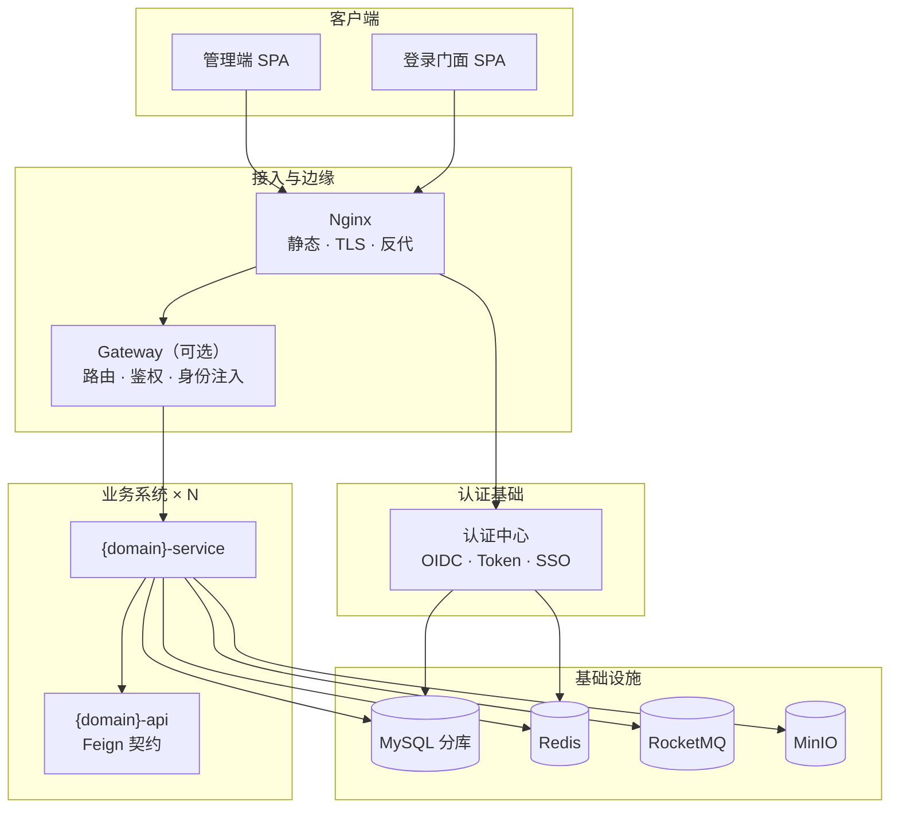
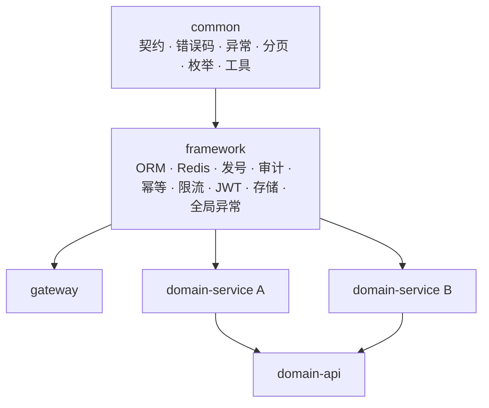
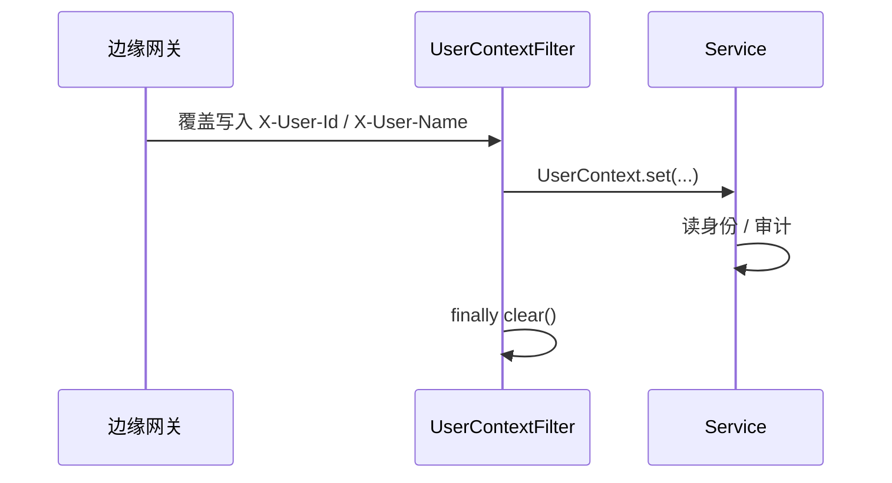
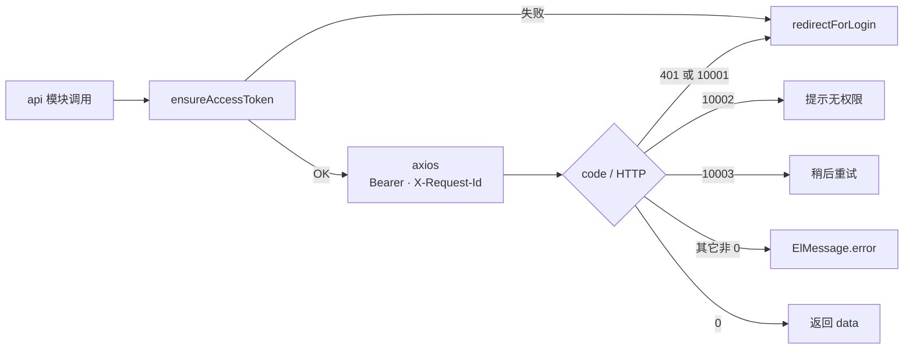
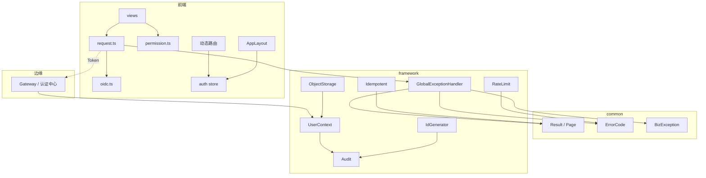

# 基础系统设计文档

> **定位**：面向多系统前后端分离仓库的**通用基础设计**——代码怎么写、系统怎么分模块、每个模块做成什么样。
> **三部分**：
> 1. [全局代码编写规范](#第一部分全局代码编写规范) — 命名、契约、结构、质量门、反模式
> 2. [基础系统整体模块设计](#第二部分基础系统整体模块设计) — 形态、分层、部署、横切能力总览
> 3. [基础系统具体模块设计](#第三部分基础系统具体模块设计) — 后端/前端每个组件的职责与接口
>
> **不绑定具体业务**：不含业务表、业务 API、版本号、端口与密钥。稳定工程红线见根目录 `CLAUDE.md`，本文是其设计面展开。

---

# 第一部分：全局代码编写规范

适用：所有 AI 编码工具与人类协作者；前后端同等约束。

## 1.1 通用约定

| 项 | 约定 |
|----|------|
| 注释与提交说明 | 中文 |
| 配置/常量 | 禁止魔法字符串、魔法数字；走枚举或 `constants` |
| 异常 | 禁止吞异常；统一全局异常处理出参 |
| 调试残留 | 提交前清除 `console.log` / `System.out.println` |
| 文档与代码不一致 | 以代码与契约为准改文档，或停下指出冲突 |

## 1.2 命名规范

| 对象 | 前端 | 后端 |
|------|------|------|
| 变量/方法 | `camelCase` | `camelCase` |
| 类/组件 | `PascalCase` | `PascalCase` |
| 常量 | `UPPER_SNAKE` | `UPPER_SNAKE` |
| 表/字段 | — | `snake_case`，表名单数 |
| URL | — | 小写 + 连字符；资源名词 |
| 包名 | — | `com.qjj.{system}.{module}` |
| 权限标识 | `system:resource:action`（全小写） | 同左 |

**方法命名**：`getXxx / listXxx / createXxx / updateXxx / deleteXxx`。

## 1.3 前端编码规范

- 技术形态：Vue3 `<script setup lang="ts">`，**禁止 Options API**。
- 组件职责单一；复杂组件拆子组件。
- **Props 向下 / Events 向上**；禁止直接改子组件状态。
- 跨组件共享状态一律 **Pinia**；按业务模块分 store。
- 请求：业务组件只调 `src/api`，**不直接 axios**。
- UI：统一 Element Plus；样式 `scoped`。
- 路由 meta：`title` / `icon` / `hidden` / `requiresAuth`；`name` 用 PascalCase。
- 权限：只用后端下发的权限字符串；**禁止硬编码角色名**。
- 类型：主键等 64 位整型出参用 `string`，**禁止 `number` 接主键**。
- 用户可见文案集中管理（常量或 i18n key），禁止散落字面量。
- 安全：用户输入默认 `v-text`；非明确需要禁用 `v-html`。
- 质量门：`npm run lint` + `npm run type-check` 必须通过。

## 1.4 后端编码规范

### 1.4.1 分层与调用

```text
Controller → Service → Mapper
```

- **禁止** Controller 直调 Mapper。
- Service 接口放 `service/`，实现类放 `service/impl/`（`XxxService` + `service/impl/XxxServiceImpl`），禁止接口与实现混在同一目录；**业务规则只在 Service**。
- 对象转换只用 MapStruct，且只放 `converter/`（唯一转换落点）。
- `@Transactional` 只加在 Service；**禁止事务内调 Feign/HTTP**。
- 只读加 `@Transactional(readOnly = true)`。

### 1.4.2 包结构（业务模块统一）

```text
com.qjj.{system}.{module}/
├── controller/   # 入口
├── dto/          # 入参
├── vo/           # 出参
├── service/      # XxxService 接口
│   └── impl/     # XxxServiceImpl 实现类（固定放 service/impl/）
├── bo/           # 服务内部对象，不对外
├── converter/    # MapStruct 唯一落点
├── mapper/
├── entity/       # 表映射，禁止出参
├── feign/
├── config/
├── constants/
├── enums/
└── util/
```

小模块可将 `dto/` `vo/` 并入 `controller/` 下，但 **entity / converter / bo / service/impl 边界不变**。

### 1.4.3 对象职责边界

| 对象 | 职责 | 落点 | 禁止 |
|------|------|------|------|
| Entity | 表映射 | 拥有表的 service/dao | 出参、跨服务 import |
| DTO | 入参 | `dto/` 或 `{domain}-api` | — |
| VO | 出参 | `vo/` 或 `{domain}-api` | — |
| BO | 服务内部 | `bo/` | 对外暴露 |

同一概念禁止 DTO/VO/BO/Entity 字段名多套。

### 1.4.4 接口与数据模型

- 契约来源：后端真实 Controller 与 OpenAPI；前端按真实字段取值。
- 枚举/字段以后端与表结构为准，**禁止前端自造枚举值**。
- RESTful：GET 查 / POST 增 / PUT 改 / DELETE 删。
- 路径版本前缀 `/api/v1/...`；破坏性变更才升版本。
- 出参 `Long`（含 `id`）一律序列化为 `String`；前端对应 `string`。
- 入参 Bean Validation（`@Valid`），禁止手写重复 if 校验。

### 1.4.5 枚举与常量

- 枚举实现 `BaseEnum<T>`（`code` + `desc`），类名 `XxxEnum`。
- 常量在 `constants`，类名 `XxxConstants`。
- 库里存 `code`，界面显示 `desc`；接口只传 `code`。

### 1.4.6 依赖落点

| 类型 | 落点 | 禁止 |
|------|------|------|
| 零配置纯契约/工具 | `{system}-common` | 依赖 ORM、Redis、数据源、MQ/MinIO/JWT |
| 需配置或中间件 | `{system}-framework` | 业务规则下沉 |
| 纯编译期工具（Lombok、MapStruct） | 可随业务模块 | — |
| 平行选型 | **禁止** | 自建线程池、自建 JWT 解析、自建 RedisTemplate、Hutool 等 |

## 1.5 数据库规范

- 表名、字段名 `snake_case`，表名单数；**禁止物理外键**。
- 业务表必须含审计字段：`create_time` / `update_time` / `create_by` / `update_by` / `deleted`。
- 类型：金额 `DECIMAL`、状态 `TINYINT`、时间 `DATETIME`、文本合理 `VARCHAR`。
- 字符串默认 `NOT NULL` + 默认值；逻辑删除默认 `0`。
- 索引：`idx_表_字段` / `uk_表_字段`；单表索引 ≤ 5。
- **`uk_` 只做数据完整性，禁止做写幂等**。
- 查询禁止 `SELECT *`；SQL 只用 `#{}` 参数化，禁止 `${}` 拼接。
- 表结构变更：SQL 随变更提供并人工执行。

## 1.6 安全规范

- 密码 BCrypt/Argon2；手机号/身份证等出参脱敏。
- **生产密钥禁止入仓**（密码、私钥、Token、连接串）→ 只进配置中心/密钥管理。
- 测试/开发账密允许入仓，须标注环境，禁止与生产同账号。
- Token：JWT；Access 短时效 + Refresh 轮转；验签封装在 framework，业务不自写解析。
- CORS 只在边缘（网关或单体服务）配置信任域名。

## 1.7 配置规范

| 文件 | profile | 要求 |
|------|---------|------|
| `application.yml` | 公共 | **无**主机/账号密码 |
| `application-local.yml` | local | 本地开发 |
| `application-test.yml` | test | 测试环境 |

- 配置项 `kebab-case` + `@ConfigurationProperties`，禁止散落 `@Value`。
- 前端本地变量走 `.env`（gitignore），命名 `SERVICE_NAME_ENV_KEY`。
- 连接信息真相源：环境文档；生产敏感项走配置中心。

## 1.8 日志与追踪

- 选型：SLF4J + Logback + Micrometer Tracing（禁止 Sleuth）。
- 每条日志含 `traceId`（MDC）；`error` 仅故障，业务失败 `warn`。
- 禁止敏感信息入日志（密码、完整 Token、证件号）；手机号脱敏。
- Logback 按天滚动；禁止业务旁路写独立日志文件。

## 1.9 横切能力使用规范

| 能力 | 规范 |
|------|------|
| 写幂等 | 关键写必须 `@Idempotent` + `Idempotent-Key`（缺省 `X-Request-Id`）；重复返回**首次 Result** |
| 限流 | 关键接口 `@RateLimit`；超限 HTTP 429 + 系统码「请求过于频繁」 |
| 上传 | 单文件 ≤ 10MB，批量 ≤ 50MB；类型白名单；UUID 文件名；逻辑删除 |
| 重试 | 指数退避最多 3 次；超时与 5xx 可重试，4xx 不重试；必须打日志 |
| 异步 | 耗时走 MQ/线程池，必须有重试与死信；**禁止业务自建线程池** |

## 1.10 提交规范

- 格式：`type(scope): subject`，type ∈ `feat / fix / refactor / docs / chore / test / perf / ci / style`。
- subject 中文祈使句、≤ 50 字符、不写句号。
- 一个提交只做一件事。

**提交前自查**

- [ ] 编译通过，lint / type-check 通过
- [ ] 无调试残留
- [ ] 无生产密钥泄露
- [ ] 改动范围与缺陷/已批准变更一一对应
- [ ] 修 bug：已基于具体报错定位根因并针对性修改

## 1.11 协作红线与反模式

| 反模式 | 正确做法 |
|--------|----------|
| 前端 `number` 接主键 | 一律 `string` |
| Controller 注入 Mapper | 只走 Service |
| 事务内调 Feign | 远程调用放事务外 |
| `${}` 拼 SQL | 只用 `#{}` |
| 吞异常 / 空测试凑数 | 显式失败并修根因 |
| 未分析报错就改代码 | 先看堆栈/HTTP/`code`/日志，定位根因 |
| 修 bug 顺手重构 | 最小范围修根因 |
| 业务自建返回体/异常/分页/ORM 配置 | common 契约 + framework 装配 |
| Entity 跨服务共享 | Entity 只在拥有表的服务 |
| 业务服务自建登录/`@PreAuthorize` | 纯边缘鉴权，身份只用 `X-User-*` |
| 业务自建雪花/UUID 主键 | 统一 framework 发号 |
| 自写 setnx / 用 `uk_` 做幂等 | `@Idempotent` + Redis |
| 网关或 Sentinel 作限流主路径 | `@RateLimit` + Redisson |
| 业务自建线程池 / `Executors` 裸用 | framework 统一装配 |
| 引入平行框架（Hutool、Druid、Jedis 等） | 遵技术栈基线；确需替换先改规范再落码 |

---

# 第二部分：基础系统整体模块设计

「基础系统」= 支撑多个业务系统的**同构工程骨架 + 横切能力 + 边缘与认证**，不含具体业务域。

## 2.1 设计目标

1. **多系统同构**：每个系统模块边界、契约、横切一致，可复制脚手架。
2. **组件单点落地**：需配置/中间件的组件只在 `framework` 封装一次。
3. **契约先行**：返回体、错误码、身份头、幂等键、分页全局统一。
4. **形态可裁剪**：微服务全链路 / 单体，核心组件设计不因形态而变。

## 2.2 仓库与系统边界

```text
.
├── frontend/{system}/     # 独立 SPA（可多个：admin / portal）
├── backend/{system}/      # 独立 Maven 多模块
├── docs/                  # 流程、环境、设计模板
├── deploy/                # nginx、db SQL、redis 等
└── openspec/              # 变更驱动制品
```

- 新增系统 = 新增 `frontend/{system}` +（如需）`backend/{system}`。
- 跨系统**禁止** import 业务代码；只走接口或已说明的薄契约模块。
- 禁止把 A 系统页面/服务/库表嵌进 B 系统。

## 2.3 总体架构



**链路（一次同步调用）**

```text
浏览器 → Nginx（TLS/静态/反代）
      → 边缘鉴权（JWT、注入 X-User-*）
      → 业务服务（校验 → Service 事务 → Mapper/Feign）
      → 统一 Result / 全局异常
      → 前端按 code / HTTP 状态分流
```

**HTTP 与 code 分流**

| 场景 | HTTP | code 语义 | 前端 |
|------|------|-----------|------|
| 未登录 / Token 无效 | 401 | `1xxxx` 未认证 | 跳转登录 |
| 无权限 | 403 | `1xxxx` 无权限 | 提示 |
| 业务/校验失败 | 200 | `2xxxxx` / `3xxxx` | 展示 msg |
| 限流 | 429 | `1xxxx` 过于频繁 | 稍后重试 |
| 服务端错误 | 5xx | `1xxxx` 系统异常 | 通用错误 |

**硬约束**

- 前端只访问本系统入口（Nginx），禁止直连业务服务。
- 业务服务不做用户鉴权；身份只信边缘注入的 `X-User-*`。
- 服务间只走 API（Feign），禁止跨服务读库、共享 Entity。
- 跨服务一致性优先最终一致（消息/补偿）。

## 2.4 后端整体模块分层

每个 `backend/{system}` 是独立 Maven 多模块：

```text
backend/{system}/
├── {system}-common            # 必选 · 纯基础
├── {system}-framework         # 必选 · 基础设施
├── {system}-gateway           # 建议 · 边缘治理（微服务形态）
├── {system}-{domain}-api      # 按需 · 跨服务契约
└── {system}-{domain}-service  # 按需 · 可运行业务
```



| 模块 | 必选 | 职责 |
|------|------|------|
| `{system}-common` | 是 | 返回体、错误码、异常、分页契约、通用枚举/常量/工具 |
| `{system}-framework` | 是 | 需配置组件统一装配与横切实现 |
| `{system}-gateway` | 建议 | 路由、鉴权、身份注入、CORS |
| `{system}-{domain}-service` | 按需 | 本域 Entity/Mapper 与业务规则 |
| `{system}-{domain}-api` | 按需 | DTO/VO、Feign、Fallback；**无** Entity/Mapper/实现 |

**脚手架落地顺序**：`common` → `framework` → 网关与认证 → 前端壳 → 再扩业务。

## 2.5 前端整体模块分层

每个 `frontend/{system}-admin`（或 portal）结构固定：

```text
src/
├── api/           # 按模块分包 + 统一 request
├── components/    # layout / common / business
├── views/         # 页面（按业务模块）
├── stores/        # Pinia
├── router/
├── types/
├── utils/
├── styles/
└── locales/
```

职责分层：

| 层 | 内容 | 依赖方向 |
|----|------|----------|
| 视图层 `views/` | 页面与业务交互 | → api / stores / components |
| 组件层 `components/` | 布局壳、通用控件 | 不直接发请求（除容器级） |
| 状态层 `stores/` | 跨组件共享 | → api |
| 接口层 `api/` | HTTP 契约 | → utils/oidc |
| 工具层 `utils/` | 令牌、权限、格式化 | 无业务依赖 |

## 2.6 部署形态对照

| 维度 | 微服务形态 | 单体形态 |
|------|-----------|----------|
| 后端模块 | common + framework + gateway + service + api | common + framework + service |
| 鉴权 | 网关 JWT + 身份注入 | 服务内验签（JWKS 指向认证中心） |
| 服务发现 | 注册中心 + `lb://` | 无；Feign 直连 URL |
| CORS | 网关 | 服务自配 |
| 适用 | 多域拆分、独立扩缩 | 单域、快速交付 |
| 组件契约 | **不变** | 同左 |

形态只影响「谁做鉴权与路由」，不影响 common/framework/前端组件设计。

## 2.7 横切能力地图（整体）

| 能力 | 归属层 | 业务侧动作 |
|------|--------|------------|
| 统一返回 / 错误码 / 异常 | common + framework | 抛 `BizException`，不自建 Result |
| 发号 / 审计 / 逻辑删除 | framework | 用 BaseEntity，不手写赋值 |
| 用户上下文 | framework | 读 UserContext |
| 写幂等 | framework | 关键写加 `@Idempotent` |
| 限流 | framework | 关键接口加 `@RateLimit` |
| 对象存储 | framework | 调 ObjectStorageClient |
| 消息异步 | framework | 经封装收发，不直绑客户端 API |
| 鉴权 / CORS / 身份注入 | gateway 或单体服务 | 不重复做 |
| 可观测（traceId） | framework | 日志规范即可 |

## 2.8 新建系统检查清单

**后端**

- [ ] common：Result / PageResult / PageQuery / ErrorCode / BizException / BaseEnum / 常量
- [ ] framework：Jackson、MyBatis、IdGenerator、AuditHandler、UserContext、Idempotent、RateLimit、GlobalExceptionHandler
- [ ] 可运行模块：三份 `application-*.yml`；包结构完整
- [ ] （微服务）gateway：LoadBalancer、JWT、身份注入、CORS、public-paths
- [ ] （跨系统）domain-api：Feign + Fallback + 超时

**前端**

- [ ] request 统一 Result 解包与 401/403/429 分流
- [ ] oidc 登录/刷新/回跳/登出
- [ ] auth store + 动态路由 + hasPermission
- [ ] AppLayout + 列表/表单/树页面模式

**工程**

- [ ] lint / type-check / 编译通过
- [ ] 无生产密钥；无调试残留

---

# 第三部分：基础系统具体模块设计

逐个说明每个组件的职责、契约与实现要点。组件名可按系统前缀替换（如 `Result` 即各 common 中的统一返回体）。

## 3.1 后端 · common 契约组件

### 3.1.1 `Result` — 统一返回体

```text
{ code: number, msg: string, data: T | null }
```

| 工厂方法 | 语义 |
|----------|------|
| `ok()` / `ok(data)` | 成功，`code = 0` |
| `fail(ErrorCode)` | 带码失败 |
| `fail(code, msg[, data])` | 显式失败 |

设计要点：

- 所有对外接口一律包 `Result`。
- **业务失败与校验失败 HTTP 200**，语义由 `code` 表达。
- 前端拦截器统一解包 `data`；业务代码不手写包装。

### 3.1.2 `PageQuery` / `PageResult` — 分页

**入参**

| 字段 | 类型 | 默认 | 说明 |
|------|------|------|------|
| `current` | long | 1 | 页码从 1 起 |
| `size` | long | 10 | 每页条数 |

排序字段白名单校验，禁止拼进 SQL。

**出参**

```text
{ records: T[], total: number, size: number, current: number }
```

与 ORM 分页对象的互转换在 `framework`。

### 3.1.3 错误码体系

| 分段 | 含义 | 约定 |
|------|------|------|
| `0` | 成功 | 固定 |
| `1xxxx` | 系统（5 位定长） | 各系统 common **对齐同一套码值** |
| `2xxxxx` | 业务（6 位 = `2` + 系统号 2 位 + 序号 3 位） | 系统号先登记 |
| `3xxxx` | 校验（5 位定长） | 字段细节放 `data` |

**系统段固定码值（全平台一致）**

| code | 语义 | HTTP |
|------|------|------|
| 0 | 成功 | 200 |
| 10001 | 未认证 | 401 |
| 10002 | 无权限 | 403 |
| 10003 | 请求过于频繁 | 429 |
| 10004 | 系统异常 | 5xx |
| 30001 | 参数校验失败 | 200 |

接口只传 `code`；前端按具体值分流，不解析号段。

### 3.1.4 `BizException` 与 `BaseEnum`

- `BizException`：携带 `ErrorCode`，由全局异常处理器翻译为 Result。
- `BaseEnum<T>`：`getCode()` + `getDesc()`；入库存 code，展示用 desc。
- 系统错误码枚举 + 业务错误码枚举分离；新增业务码先分配号段再进枚举。

### 3.1.5 常量与工具

- `CommonConstants`：Header 名（`X-User-Id` / `X-User-Name` / `X-Request-Id`）、分页默认值等。
- `PermissionConstants`：权限标识字符串常量（与前端共用字符串）。
- 脱敏等纯函数工具可放 common；需配置的工具不放 common。

---

## 3.2 后端 · framework 基础设施组件

### 3.2.1 `GlobalExceptionHandler`

| 来源 | HTTP | code | 说明 |
|------|------|------|------|
| `BizException` | 200 | 业务码 | 透传 msg |
| 参数校验失败 | 200 | `30001` | 字段错误进 `data` |
| 认证/授权 | 401/403 | `10001`/`10002` | — |
| 限流 | 429 | `10003` | — |
| 未知异常 | 5xx | `10004` | 记 error（带 traceId），**不返回堆栈** |

统一 `@RestControllerAdvice`；禁止业务另写全局处理。

### 3.2.2 `JacksonSupportConfiguration` — Long 序列化

- 出参 `Long` → `String`（含主键）。
- 全局 `ObjectMapper` 只在此配置；禁止字段上散落 `@JsonSerialize`。
- 前端对应类型一律 `string`。

### 3.2.3 `MybatisSupportConfiguration`

- ORM 装配、分页插件、逻辑删除（`@TableLogic`）。
- 业务模块不得自配数据源/插件。

### 3.2.4 `IdGenerator` — 16 位发号

| 项 | 约定 |
|----|------|
| 主键 | `Long` / `BIGINT` |
| 构成 | **16 位定长** = 业务日期 `yyyyMMdd`（8 位，`Asia/Shanghai`）+ 当日序列（8 位） |
| 实现 | 号段式：DB 序列表缓存段，内存自增；段耗尽再取 |
| 禁止 | 数据库自增、业务雪花/UUID 主键 |

例外：RBAC 资源树等可用层级短号（见专项规范）；其余实体一律 16 位发号。

### 3.2.5 `AuditMetaObjectHandler` — 审计填充

| 字段 | 填充 |
|------|------|
| `createTime` / `updateTime` | 当前时间（业务时区） |
| `createBy` / `updateBy` | `UserContext.userId` |
| `deleted` | 默认 0 |

业务禁止手写审计/逻辑删除赋值。

### 3.2.6 `UserContext` / `UserContextFilter` — 身份上下文



| 项 | 约定 |
|----|------|
| Header | `X-User-Id`（字符串化 Long）、`X-User-Name` |
| 写入方 | **仅边缘**认证后覆盖写入 |
| Filter | 解析 Header → ThreadLocal；请求结束必须 clear |
| 业务 | 不信任客户端同名头；以覆盖写入值为准 |

单体形态：服务内验签成功后填充，业务读法不变。

### 3.2.7 `@Idempotent` / `IdempotentAspect` — 写幂等

```text
@Idempotent(keyPrefix = "biz:create", ttlSeconds = 3600)
```

| 步骤 | 行为 |
|------|------|
| 1 | 取 `Idempotent-Key`，缺省 `X-Request-Id` |
| 2 | Redis `SET NX`（TTL） |
| 3 | 成功 → 执行业务，缓存**首次 Result** |
| 4 | 重复 → 直接返回首次 Result |

禁止：业务自写 setnx、仅前端防重、`uk_` 幂等、重复时裸抛异常。

### 3.2.8 `@RateLimit` / `RateLimitAspect` — 接口限流

```text
@RateLimit(keyPrefix = "file:upload", dimension = USER, permits = 20, windowSeconds = 60)
```

| 项 | 约定 |
|----|------|
| 维度 | `USER` / `IP` / `INTERFACE` |
| 底层 | Redisson `RRateLimiter` |
| 超限 | HTTP 429 + `10003` |

限流主路径在业务服务；网关不作限流主路径。

### 3.2.9 `ObjectStorageClient` — 对象存储

| 能力 | 约定 |
|------|------|
| 封装 | MinIO/S3 SDK **只在 framework**，业务不直绑 SDK |
| 上传 | 单文件 ≤ 10MB，批量 ≤ 50MB；类型白名单；UUID 文件名 |
| 访问 | 预签名 URL |
| 删除 | 元数据逻辑删除 + 对象清理策略 |
| 元数据 | 业务表自行持有（objectKey、原始名、大小、contentType…） |

### 3.2.10 消息与线程池

- MQ 收发、消费重试、死信由 framework 统一；业务不直绑客户端 API。
- 异步线程池由 framework 装配；**禁止** `Executors` 裸用。

---

## 3.3 后端 · gateway 边缘组件

| 组件能力 | 设计 |
|----------|------|
| 路由 | `lb://{serviceId}`；**显式依赖 LoadBalancer**（缺则有实例仍 503） |
| 鉴权 | JWT 资源服务器验签；唯一鉴权点 |
| 放行 | 配置 `public-paths`；OPTIONS 放行 |
| 身份注入 | JWT `sub` / `preferred_username` → 覆盖 `X-User-*` |
| CORS | **唯一归属**，信任域名配置化 |
| 错误响应 | 401/403/429/5xx + `{code,msg,data}` |
| 日志 | 访问日志、`X-Request-Id`、trace 透传 |
| 超时 | 连接/读取超时可配（熔断暂不引入） |

**明确不放进网关**：业务规则、限流主路径、静态资源、TLS、复杂编排。

### 3.3.1 认证中心（独立设计文档）

认证中心是可独立部署的基础组件（单体），负责统一登录、OIDC/OAuth2 发行、令牌与会话治理。业务系统**只验签**，不登录、不发 Token。

| 能力域 | 摘要 |
|--------|------|
| 协议 | 授权码 + PKCE、`/oauth2/*`、JWKS |
| 令牌 | Access 短时效 + Refresh 轮转；Redis 活动态 + DB 台账 |
| 会话 | SSO Cookie、单点登出 |
| 登录 | 账密门面、失败限制、登录审计 |
| 客户端 | OAuth Client CRUD、密钥轮换 |

**完整设计**（端点、时序、Token 管理、管理 API、配置与验收）见独立文档：[`auth-center-design.md`](./auth-center-design.md)。

### 3.3.2 RBAC 模块（各业务系统可同构自持）

**四表**：`sys_menu` · `sys_role` · `sys_user_role` · `sys_role_menu`

| 能力 | 契约 |
|------|------|
| 权限标识 | `system:resource:action` |
| 菜单下发 | `/me/menus` → 前端动态路由 |
| 按钮权限 | `/me/permissions` → 字符串数组 |
| 校验 | 边缘可做路由级；业务服务不用 `@PreAuthorize` 拦接口 |
| data_scope | 列预留，语义随变更锁定 |

---

## 3.4 前端 · 具体模块设计

### 3.4.1 `api/request.ts` — 请求封装



| 项 | 约定 |
|----|------|
| baseURL | `/api/v1`（经接入层） |
| 请求头 | `Authorization: Bearer` + `X-Request-Id` |
| 解包 | 只返回 `data`；业务不看包装 |
| 参数 | 丢弃 `undefined` / `null` / `''` |
| 导出 | `http.get/post/put/delete` |

### 3.4.2 `utils/oidc.ts` — 令牌与登录

| 能力 | 约定 |
|------|------|
| 登录 | 跳转统一认证入口，带回跳地址 |
| 存储 | `accessToken` / `refreshToken` / `idToken` |
| 刷新 | AT 过期用 RT 静默刷新；失败清空跳登录 |
| 回调 | `OidcCallback.vue`：收 code → 换 token → 回原路由 |
| 登出 | 清本地 + 调认证中心登出 |
| 展示名 | ID Token claim（如 `preferred_username`） |

### 3.4.3 `stores/auth.ts` — 权限状态

| State | 来源 | 用途 |
|-------|------|------|
| `menus` | `/me/menus` | 动态路由 + 侧边栏 |
| `permissions` | `/me/permissions` | 按钮显隐 |
| `operatorName` | ID Token | 顶栏 |
| `initialized` | 本地 | 防重复拉取 |

`utils/permission.ts`：`hasPermission('system:resource:action')`。

### 3.4.4 `router/index.ts` — 动态路由

| 项 | 约定 |
|----|------|
| meta | `title` / `icon` / `hidden` / `requiresAuth` |
| 生成 | 登录后按 `menus` 动态 `addRoute` |
| 守卫 | 无 Token → 登录；有 Token 未初始化 → `init`；404 兜底 |

### 3.4.5 `components/AppLayout.vue` — 应用壳

- 左侧菜单树（层级来自 menus）+ 顶栏（操作员、登出）+ 主内容区。
- 不直接写业务请求；只消费 auth store。

### 3.4.6 页面模式组件

| 模式 | 典型 | 要点 |
|------|------|------|
| **P-List** | 实体管理列表 | 筛选 + 表格 + 分页 + 行操作；删除二次确认；批量需确认 |
| **P-Tree** | 菜单/目录 | 左树右表或树表；支持子级新增 |
| **D-Form** | 新建/编辑弹窗 | 校验就地提示；提交防重 |
| **D-Panel** | 角色授权 | 树勾选 + 半选语义；保存全量/增量 |

统一交互：空态、加载、失败重试、成功后刷新当前页。

### 3.4.7 `types/` — 类型契约

- `Result<T>`、`PageResult<T>`、`MenuVO`、分页入参等与后端 VO 对齐。
- 主键字段类型 `string`；枚举用后端 `code` 字面量联合或常量对象。

---

## 3.5 组件依赖全景



---

## 附录 A · 基础系统 vs 业务系统

| | 基础系统（本文） | 业务系统 |
|--|------------------|----------|
| 内容 | common / framework / gateway / 认证 / RBAC 壳 / 前端骨架 | 具体业务表、API、页面 |
| 设计文档 | 本文 | 各系统设计 + openspec 变更 |
| 可变性 | 稳定契约，改前走变更 | 随业务迭代 |

## 附录 B · 术语

| 术语 | 含义 |
|------|------|
| system | 仓库内可独立构建部署的前后端对 |
| domain-service | 按业务域拆分的可运行后端模块 |
| domain-api | 跨服务 DTO/Feign 边界 |
| common / framework | 纯契约层 / 基础设施层 |
| 身份头 | `X-User-Id` / `X-User-Name`，边缘注入 |
| 权限标识 | `system:resource:action` |
| 发号 | 16 位业务日期 + 日序列主键 |
| 幂等键 | `Idempotent-Key` 或 `X-Request-Id` |
