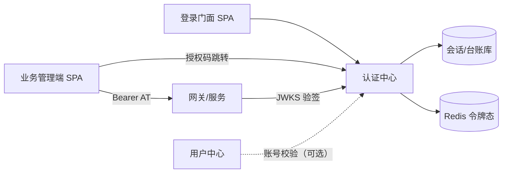
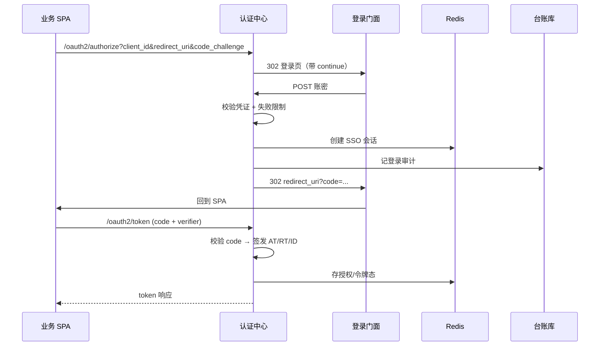

# 认证中心 · 组件设计

> **定位**：基础系统中的**独立认证组件**——统一登录、OIDC/OAuth2 发行、令牌与会话管理。
> **关系**：本文是[《基础系统设计文档》](./architecture-design.md)第三部分「认证中心」的展开；主文档仅保留索引。不绑定具体业务表与环境参数。
> **形态**：独立可部署服务（单体），对外提供协议端点与管理 API；业务系统**只验签**，不登录、不发 Token。

---

## 1. 目标与边界

### 1.1 目标

| 目标 | 说明 |
|------|------|
| 统一登录入口 | 全平台唯一账密/OIDC 登录门面，业务系统不各自做登录 |
| 标准协议 | OIDC / OAuth2（授权码等），多 RP（业务 SPA）可接入 |
| 令牌发行与治理 | Access / Refresh / ID Token 生命周期、刷新轮转、吊销 |
| SSO / 登出 | 会话级单点登录；支持单点登出与 RP 登录态清理 |
| 客户端管理 | OAuth Client（业务系统）注册、密钥、回调地址 |
| 安全审计 | 登录尝试、敏感操作可查 |

### 1.2 边界（明确不做）

| 不做 | 归属 |
|------|------|
| 用户主数据、组织、资料 | 用户中心（业务侧） |
| 业务系统 RBAC 菜单/按钮 | 各业务系统自持 |
| 业务 API 鉴权拦截 | 网关 / 各服务边缘 |
| 业务表、业务规则 | 各业务系统 |
| 密码找回/注册等 C 端账号产品能力 | 除非另开变更，默认仅内部账号登录 |

### 1.3 与周边系统关系



- **登录门面**：唯一账密 UI，跳转/回跳由认证中心编排。
- **业务 SPA**：作为 OIDC RP，拿 Token 调业务 API。
- **网关/业务服务**：用 JWKS 验签，信任 `sub` 等 claim，不调登录接口。
- **用户中心**：可选；账号源可在认证中心本地或经契约校验。

---

## 2. 形态与模块划分

### 2.1 形态

- **单体服务**，不引入网关、不引入服务发现。
- 前后端分离：协议端点 + 管理 API + 登录门面 SPA +（可选）管理端 SPA。
- 配置：三份 `application-*.yml`；生产敏感项走配置中心。

### 2.2 后端模块

```text
backend/auth/
├── auth-common        # Result / 错误码 / 异常 / 分页（与其它系统对齐）
├── auth-framework     # 发号 / 审计 / UserContext / 幂等 / 限流 / Jackson / 全局异常
└── auth-service       # 可运行：协议 + 登录 + Token + 客户端 + 审计 + 管理 API
```

与其它系统相同的 common/framework 契约不重复定义；**差异只在 service 内协议与安全组件**。

### 2.3 service 内功能分区

| 分区 | 职责 |
|------|------|
| protocol | OIDC/OAuth2 端点、授权、Token、JWKS |
| login | 账密认证、登录失败限制、会话、登录门面跳转 |
| token | 签发、刷新轮转、吊销、台账 |
| client | OAuth Client CRUD、密钥轮换、状态 |
| audit | 登录尝试、敏感操作 |
| security | 过滤器、Provider、JWT 转换、登出 |
| rbac（可选） | 认证侧管理端自身的菜单/角色 |

---

## 3. 实现技术选型（Spring 官方栈）

> 本组件采用 **Spring 官方 OAuth2/OIDC 实现**（Spring Authorization Server，简称 SAS），不引入 Keycloak、Auth0、自研 OAuth 协议栈。
> **重要现实**：官方默认链路**不能直接满足**「公开 SPA + PKCE + Refresh 轮转 + SSO Cookie + 跨域换票」组合场景；项目里对 SAS 扩展点做了**多处定制**，调通验证成本高。本节把**改造点、链路细节、踩坑结论**写清，避免重走一遍。

### 3.1 技术栈总览

| 层次 | 选型 | 作用 |
|------|------|------|
| 运行时 | Spring Boot 3.x（Servlet） | 单体可运行服务 |
| 协议内核 | **Spring Authorization Server（SAS）** | OIDC/OAuth2 端点、授权码、Token 签发与吊销 |
| 安全框架 | Spring Security 6 | 双过滤链、表单登录、鉴权 |
| JWT | **spring-security-oauth2-jose（Nimbus）** | JWK（RS256）、签发/验签 |
| 资源服务器 | `oauth2-resource-server` | 管理 API 验签（消费自己的 JWT） |
| 会话/令牌态 | Redis（Spring Data Redis） | SSO 会话、`OAuth2Authorization` 序列化、RT 索引 |
| 台账/配置 | MySQL + MyBatis-Plus | Client、RT 台账、grant、审计、登录尝试 |
| 密码 | `DelegatingPasswordEncoder`（默认 bcrypt） | 凭证 |
| 横切 | 与其它系统同一 `framework` | 幂等/限流/发号/审计 |

### 3.2 为何用 Spring Authorization Server（以及为何仍要改）

| 考量 | 说明 |
|------|------|
| 官方协议栈 | 发现文档、JWKS、PKCE、revocation 按 OIDC 规范演进 |
| SPI 明确 | Client 仓库、Authorization 存储、Token 生成器、Customizer、认证 Converter/Provider 都可插拔 |
| 与资源服务器同栈 | 网关/业务侧 `oauth2-resource-server` + JWKS，无私有协议 |
| **现实** | Public Client 的 refresh、Authorization 落点、会话恢复、跨域换票、登出端点占用等，**默认行为与 SPA 场景冲突**，必须在官方扩展点上定制，而不是 fork 协议 |

### 3.3 核心装配结构（双 SecurityFilterChain）

```text
SecurityFilterChain（双链，顺序敏感）
├── @Order(1) authorizationServerSecurityFilterChain   # SAS 协议端点
│     OAuth2AuthorizationServerConfiguration.applyDefaultSecurity(http)
│     OAuth2AuthorizationServerConfigurer
│       ├── clientAuthentication
│       │     converters.add(0, PublicClientRefreshAuthenticationConverter)  # ★扩展
│       │     authenticationProvider(PublicClientRefreshAuthenticationProvider)  # ★扩展
│       ├── tokenRevocationEndpoint
│       └── oidc(Customizer.withDefaults())
│     http.cors(...)          # ★必须：否则 SPA POST /oauth2/token 无 ACAO
│     http.csrf(disable)
│     addFilterAfter(SsoSessionAuthFilter, SecurityContextHolderFilter)  # ★必须在 authorize 之前
│     exceptionHandling(PortalLoginAuthenticationEntryPoint)  # 未登录 → 登录门面
│
└── securityFilterChain（登录页 / 管理 API / 内部）
      authenticationProvider(CredentialAuthenticationProvider)
      addFilterAfter(SsoSessionAuthFilter, SecurityContextHolderFilter)  # 两条链都挂
      formLogin: loginProcessingUrl = /api/login   # ★与 GET /login 页面路由拆开
      oauth2ResourceServer.jwt(RbacJwtAuthenticationConverter)  # ★验签后按 sub 装 RBAC
      exceptionHandling(PortalLoginAuthenticationEntryPoint)  # ★必须写在 formLogin 之后
      permitAll: /oauth2/** /.well-known/** /login /api/login /connect/logout /internal/** /actuator/**
```

**过滤器额外注册（Servlet FilterRegistrationBean，最高优先级）**

| Filter | URL | 为何必须 |
|--------|-----|----------|
| `OidcRequestValidationFilter` | `/oauth2/authorize` | 精确校验 `redirect_uri`/`client_id`，非法直接 400，**不能** 302 去登录 |
| `OidcLogoutFilter` | `/connect/logout` | **抢占** SAS `end_session`；清 SSO、吊销 grant、校验 `post_logout_redirect_uri` |

### 3.4 对 SAS 官方逻辑的定制清单（核心）

> 下列都是「官方默认 → 本项目改法」；改错会表现为 `invalid_client` / `invalid_grant` / 500 / 10004。

| # | 官方默认 | 问题 | 本项目改法 |
|---|----------|------|------------|
| 1 | Public Client 认证走 `PublicClientAuthenticationConverter`，**刷新时也要求 PKCE `code_verifier`** | SPA `grant_type=refresh_token` 只带 `client_id` → `invalid_client` | 新增 `PublicClientRefreshAuthenticationConverter`：仅对 `refresh_token + client_id` 放行；`PublicClientRefreshAuthenticationProvider` 完成 client 校验（`NONE`） |
| 2 | Public Client 默认**不签发 Refresh Token**（或生成器链不覆盖） | SPA 无法静默续期 | `PublicClientRefreshTokenGenerator` 纳入 `DelegatingOAuth2TokenGenerator`；同一次签发/刷新内 **in-flight 幂等**，避免一次请求生成两个 RT |
| 3 | `OAuth2AuthorizationService` 默认 `InMemory`（单机示例） | 重启丢失；多实例不共享；`findByToken` 查不到 → `invalid_grant` | `RedisOAuth2AuthorizationService`：序列化整个 `OAuth2Authorization` 入 Redis；对 **code / AT / RT / id_token** 全部建索引；`sha256(RT) → authorizationId` 兜底 |
| 4 | `getPrincipalName()` 常是**登录名**（如 `admin`） | 业务把它 `Long.valueOf` → `NumberFormatException` | `AuthPrincipal.getUsername()` 返回 **userId 字符串**；`displayName()` 才给 `preferred_username` |
| 5 | `authorizationId` 多为 **UUID** | 业务 `Long.valueOf` 当主键炸 | `resolveBizGrantId`：非数字映射 16 位业务 id，与 `auth_grant` 同键 |
| 6 | Token claim 含完整 principal / scope 混杂 | JWT 膨胀、信息泄露、claim 不稳定 | `OAuth2TokenCustomizer` **白名单最小集**；`preferred_username` 从 `Authentication.getPrincipal()` 剥一层再取 |
| 7 | SAS 占用 `/connect/logout` 作 OIDC end_session，且要认证 | 业务 Controller 进不去，401 Bearer | `OidcLogoutFilter`（HIGHEST_PRECEDENCE）**独占**该路径：清 Cookie、按用户吊销 RT + `removeAuthorization` |
| 8 | 未认证时 `OAuth2AuthorizationEndpointFilter` **`chain.doFilter` 穿过**（约 181–193 行），期望 EntryPoint 收口 | SSO Filter 挂太晚 → 请求掉进 MVC → `No static resource oauth2/authorize` → 10004 | `SsoSessionAuthFilter` 必须 `addFilterAfter(..., SecurityContextHolderFilter.class)`，保证 **authorize 之前**恢复会话；AS 链与默认链都要挂 |
| 9 | `formLogin` 会把 `AuthenticationEntryPoint` 改回相对路径 `/login` | `GET /login` 无 handler → 10004 | `exceptionHandling` **写在 `formLogin` 之后**；`GET /login` 由 `LoginPortalRedirectController` 302 到 portal |
| 10 | 默认链上 CORS ≠ AS 链上 CORS | `POST /oauth2/token` 跨域换票无 `ACAO`，浏览器拦掉，前端像「登录失败」 | **两条链都** `http.cors(corsConfigurationSource)`，且 SPA `origin` 精确登记 |
| 11 | 吊销只删 RT 哈希 | `OAuth2Authorization` 仍可 `findByToken` 成功 → 登出后仍能刷 | `revokeGrant` 必须 **同时** `removeAuthorization`（删 SAS 授权对象） |
| 12 | 管理 API 若只信 JWT 默认 authorities（`SCOPE_*`） | Claims 最小集不含权限码 → 10002 | `RbacJwtAuthenticationConverter`：验签后按 `sub` 查 RBAC 装 authorities；SSO 恢复会话同样装 |

### 3.5 令牌与存储细节

| 项 | 实现细节 |
|----|----------|
| AT | SAS `JwtGenerator` + `NimbusJwtEncoder`（RS256，kid 固定）；TTL 来自 `oauth_client.access_token_ttl_sec` |
| RT | 不透明 UUID；TTL 来自 `refresh_token_ttl_sec`（默认 7 天）；`reuseRefreshTokens=false` **轮转** |
| ID Token | SAS OIDC 默认链路 + 最小 claim customizer |
| 授权对象 | `OAuth2Authorization` **Base64 序列化进 Redis**（TTL 数小时级）；token 索引键 `type + tokenValue` |
| RT 台账 | `TokenManagementService`：`sha256(RT)` 为键；存 grantId/userId/clientId；`consume`/`isRotated`/`revokeRotated`（重用 → 吊销 grant 全链） |
| 兑底 | `sha256(RT) → authorizationId`，防索引缺失 |
| 为何不用 InMemory | 换票/刷新跨请求、可重启、可多实例；否则表现为「偶发 invalid_grant」 |

**Public Client Refresh 同事件幂等**：一次 refresh 流程 SAS 可能多次 `generate`；`PublicClientRefreshTokenGenerator` 用 in-flight map 保证 **同一 authorizationId 只产出一个 RT**，否则「响应里的 RT」≠「save 进 Redis 的 RT」→ 下次刷新必挂。

### 3.6 登录 / SSO / 登出实现细节

| 主题 | 细节 |
|------|------|
| 账密入口 | 页面 `GET /login`（portal SPA）与验密 **`POST /api/login`**（`loginProcessingUrl`）**禁止同名同方法**，否则代理死循环 |
| 密码 | `CredentialAuthenticationProvider`：bcrypt + `LoginAttemptService` 失败锁定 |
| SSO 载体 | HttpOnly Cookie（如 `AUTH_SSO_SESSION`）+ Redis 会话 |
| Host 约定 | **全链路统一 `localhost`**，禁止与 `127.0.0.1` 混用——Cookie 以 host 为准且**忽略端口** |
| 会话恢复 | `SsoSessionAuthFilter` 在 `SecurityContextHolderFilter` 之后；同时从 RBAC 装 authorities |
| 登出 | `/connect/logout` 被 `OidcLogoutFilter` 独占：清 Cookie → 按用户吊销 RT/grant + 删 `OAuth2Authorization` → 校验 `post_logout_redirect_uri` 白名单 |
| 身份进 JWT | `AuthPrincipal`：`username`=userId 字符串，`displayName`=登录名 → `preferred_username` |

### 3.7 调通认证时的真实踩坑（浓缩）

| 现象 | 根因 | 结论 |
|------|------|------|
| `NumberFormatException: "admin"` | SAS `principalName` 当 userId 用 | principalName ≠ 业务主键 |
| `/oauth2/token` 只有 500 | 异常在 **过滤器链**，不走 `@RestControllerAdvice` | 排查用 `include-stacktrace` / 服务日志 |
| `preferred_username` 变成 `Authentication#toString` | Customizer 未剥 `Authentication` | 先 `getPrincipal()` 再取显示名 |
| refresh → `invalid_client` | Public Client 刷新仍走 PKCE 认证 | 单独 Refresh Converter/Provider |
| refresh → `invalid_grant` | InMemory / 索引不全 / 响应 RT 与入库 RT 不一致 | Redis 全 token 索引 + 生成器幂等 |
| authorize → 10004 | SSO Filter 晚于 authorize；或 EntryPoint 被 formLogin 覆盖 | Filter 顺序 + `exceptionHandling` 写在 formLogin 后 |
| 换票成功但前端报登录失败 | `/oauth2/token` 响应无 CORS 头 | **AS 链**上必须 `http.cors` |
| 登出后仍能 refresh | 只删 RT 未删 `OAuth2Authorization` | 吊销必须 `removeAuthorization` |
| SSO 完全不生效 | `localhost` / `127.0.0.1` 分裂 | 统一 host |
| 登录页转圈 | Vite 把 `GET /login` 整段代理到 9080 形成 302 环 | 拆路径：页面 `/login`、验密 `/api/login` |
| `/me/*` 空、10002 | AuthContext 只认 `X-User-Id`；JWT/SSO 路径未回填；authorities 未从 RBAC 装 | 双通道身份 + 验签/恢复时装权限 |
| 换票后业务 503 | 网关 `lb://` 缺 LoadBalancer | 显式 `spring-cloud-starter-loadbalancer` |

### 3.8 与横向组件的技术接线

| 组件 | 接法 |
|------|------|
| Redis | Authorization/会话/RT 索引；Redisson `@RateLimit` |
| 幂等 | 管理写接口 `@Idempotent`（SET NX + 首次 Result 回放） |
| 限流 | 登录、换票等敏感接口 `@RateLimit` |
| 发号 | Client/审计等业务主键走 framework `IdGenerator` |
| 审计 | 登录尝试、Client 变更、密钥轮换、吊销、RT 重用 |
| 用户中心 | 可选 OpenFeign；**禁止事务内调用** |

### 3.9 明确不用的平行方案

| 不引入 | 替代 |
|--------|------|
| Keycloak / Auth0 / 自研 OAuth 协议实现 | Spring Authorization Server |
| 自研 JWT 签名/解析 | Nimbus（随 Boot BOM） |
| 纯 Session、无 OIDC | OIDC + SSO 会话，多 RP 标准接入 |
| Token 落库逐请求验签 | JWT 本地验签 + JWKS |
| 业务服务直连认证库表 | 只验签 / 契约 API |
| fork 改 SAS 源码 | 只用官方 SPI 定制（Converter/Provider/Generator/Service/Filter） |

## 4. 协议与端点设计

### 4.1 标准端点（OIDC / OAuth2）

| 端点 | 用途 |
|------|------|
| `/oauth2/authorize` | 授权码入口 |
| `/oauth2/token` | 换 AT / 刷新 RT / 换码 |
| `/oauth2/jwks` | 验签公钥 |
| `/oauth2/introspect` | 令牌检查（内网） |
| `/oauth2/revoke` | 吊销 |
| `/oauth2/logout` | 单点登出 |
| `/userinfo` | 用户信息（受保护） |
| `/.well-known/openid-configuration` | 发现文档 |

业务系统配置：issuer、JWKS、client_id、redirect_uri；**不共享密钥**。

### 4.2 授权模式

| 模式 | 使用 |
|------|------|
| 授权码 + PKCE | 管理端 SPA（推荐默认） |
| 授权码 + client secret | 机密客户端（如有服务端 RP） |
| Refresh Token | 静默续期，轮转 |

### 4.3 令牌模型

| Token | 形态 | 时长（默认） | 说明 |
|-------|------|--------------|------|
| Access Token | JWT | 10 分钟（5–15 可配） | 业务 API 调用 |
| Refresh Token | 不透明 / JWT | 7 天 | 轮转；可吊销 |
| ID Token | JWT | 随会话 | 给 RP 展示身份 claim |

**JWT 关键 claim（约定）**

| claim | 含义 |
|-------|------|
| `sub` | 用户主键（稳定） |
| `preferred_username` | 登录名/显示名 |
| `permission`（可选） | 权限标识数组（供网关转换） |
| `iss` / `aud` / `exp` / `jti` | 标准 |

网关/服务从 `sub` / `preferred_username` 注入 `X-User-*`，不在业务层解析口令。

---

## 5. 登录与会话

### 5.1 登录时序（授权码 + 门面）



### 5.2 SSO 会话

| 项 | 约定 |
|----|------|
| 会话载体 | 浏览器 Cookie（HttpOnly、Secure）+ Redis 会话态 |
| 判定 | 有有效 SSO 会话则 `/oauth2/authorize` 免账密直接同意/发码 |
| 登出 | 清 SSO 会话；通知已登录 RP（back-channel / 前端跳转） |
| 与业务 Token 分离 | 清业务 AT/RT 不等于清 SSO，反之亦然；登出策略在变更中裁决 |

### 5.3 凭证与登录安全

| 项 | 约定 |
|----|------|
| 密码存储 | BCrypt / Argon2 |
| 失败限制 | 短时间多次失败锁定或延时（阈值配置化） |
| 传输 | 全程 HTTPS |
| 时钟 | 业务时区 `Asia/Shanghai` 记审计；Token 用标准时间 |

---

## 6. Token 管理

| 能力 | 设计 |
|------|------|
| 存储 | **Redis** 存会话/授权/令牌活跃态；**DB** 存台账（授权记录、吊销、审计） |
| 刷新 | RT 单次有效（轮转）；旧 RT 失效 |
| 吊销 | 支持按用户/客户端/令牌 `jti` 吊销；验签侧可查 introspect 或短 AT 自然过期 |
| 台账 | 记 client_id、sub、颁发时间、过期、吊销时间（可追溯） |

---

## 7. 客户端（RP）管理

| 字段/能力 | 说明 |
|-----------|------|
| client_id / client_secret | 机密客户端；secret 只展示一次，支持轮换 |
| redirect_uris | 精确匹配，禁止宽泛通配 |
| grant_types / scopes | 按需授权 |
| 状态 | 启用/禁用 |
| 管理 API | `/api/v1/clients` 增删改查、状态、密钥轮换；需管理端登录 |

密钥入仓：生产 secret 禁止入仓；仅测试环境可入配置并标注。

---

## 8. 管理 API（示意）

> 经服务内鉴权（管理端会话或管理 Token）；统一 `{code,msg,data}`、`/api/v1`、Long→String。

| 模块 | 能力 |
|------|------|
| clients | 列表/详情/创建/更新/启停/轮换密钥 |
| grants | 授权记录查询、撤销 |
| tokens | 活跃令牌/会话查询、吊销 |
| login-attempts | 登录尝试列表（审计） |
| audit | 敏感操作审计列表 |
| users（可选） | 仅认证侧账号管理；主数据仍在用户中心 |

---

## 9. 前端

### 9.1 登录门面 `auth-portal`

| 项 | 约定 |
|----|------|
| 职责 | 唯一账密表单；处理 continue/回跳；错误提示 |
| 不做 | 业务菜单、动态路由、业务 API |
| 安全 | 无 `v-html`；表单防重提交 |

### 9.2 认证管理端 `auth-admin`（可选）

| 项 | 约定 |
|----|------|
| 职责 | Client / Grant / Token / 审计 / 认证侧 RBAC |
| 结构 | 与其它管理端同构：`api / stores / router / views` |
| 登录 | 自身也走 OIDC（吃自己的狗粮）或会话登录，变更中裁决 |

---

## 10. 配置契约（结构示意）

```yaml
# 公共 application.yml — 不写主机与密钥
auth:
  issuer: ${AUTH_ISSUER}
  access-token-ttl: 10m
  refresh-token-ttl: 7d
  sso:
    cookie-name: AUTH_SSO
    ttl: 8h
  login:
    max-failures: 5
    lock-minutes: 15
```

敏感项（DB/Redis/密钥）只进 local/test 标注配置或配置中心。

---

## 11. 安全约定

| 主题 | 约定 |
|------|------|
| 密码 | 只存哈希；日志禁止明文/完整 Token |
| redirect_uri | 精确白名单 |
| CSRF | 登录与管理表单防 CSRF（按框架惯例） |
| CORS | 仅信任登记域名；协议端点与管理 API 分策略 |
| 审计 | 登录成功/失败、客户端变更、密钥轮换、吊销必记 |
| 依赖 | 实现库随 Boot BOM（如 spring-security-oauth2-jose / Nimbus）；禁止平行 JWT 栈 |

---

## 12. 与其它基础模块的接线

| 模块 | 关系 |
|------|------|
| framework 发号/审计 | 客户端、审计表主键与 `create_by` 等同构 |
| framework 幂等/限流 | 管理写接口 `@Idempotent`；登录/换 token `@RateLimit` |
| 网关 | 只验签 + 注入 `X-User-*`；不在网关做登录 |
| 业务 common 错误码 | 未认证 `10001`、无权限 `10002` 等保持一致 |
| RBAC | 业务权限在各业务系统；认证管理端可自持一套管理菜单 |

---

## 13. 验收清单

**协议**

- [ ] 发现文档 / JWKS 可访问
- [ ] 授权码 + PKCE 全流程走通
- [ ] AT/RT 刷新轮转；过期与吊销行为正确

**登录与会话**

- [ ] 门面登录成功回跳原路由
- [ ] SSO：二次进业务系统免登录
- [ ] 登出后 SSO 与业务 Token 策略符合约定

**管理**

- [ ] Client CRUD、secret 只显示一次、轮换后旧 secret 失效
- [ ] 登录尝试与敏感操作可审计

**安全**

- [ ] 无生产密钥入仓；密码哈希存储
- [ ] redirect_uri 精确校验
- [ ] 日志无明文口令/完整 Token

---

## 14. 相关文档

| 文档 | 关系 |
|------|------|
| [《基础系统设计文档》](./architecture-design.md) | 总览与其它组件契约 |
| 《网关设计》 | 验签与身份注入 |
| 《RBAC 设计》 | 业务权限模型 |
| `CLAUDE.md` | 工程红线与错误码段 |
| `docs/template/fixbug/2026-09-24-startup-auth-oidc.md` | OIDC/Token 调通过程中的真实缺陷与改法 |
| `docs/template/fixbug/2026-09-25-unify-login-sso-gateway.md` | SSO、统一登出、跨域换票、网关踩坑 |
